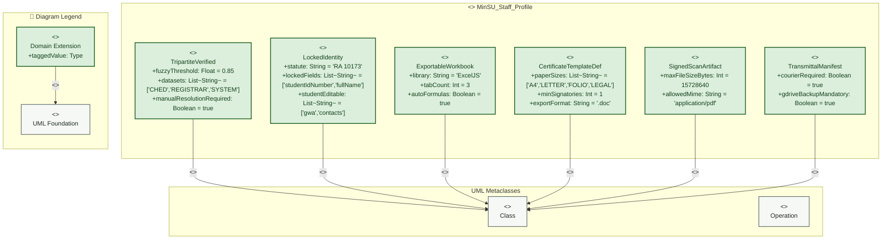

# Staff Coordinator — Profile Diagram

> **Role:** `STAFF`  
> **Diagram Type:** Profile Diagram  
> **Target Domain:** Annex Operations, Verification, and Transmittal Tracking

---

## 1. Purpose

The Profile Diagram defines domain-specific UML stereotypes and tagged values for the Staff Coordinator domain, including 3-way verification rules, RA 10173 identity locks, certificate layouts, and transmittal manifests.

---

## 2. Mermaid Profile Diagram

---

## 3. Diagram Legend & Symbol Guide

| Visual Symbol | Syntax / Style | UML Profile Mechanism | MinSU Governance Application |
|---|---|---|---|
| `<<metaclass>>` Box | `fill:#F6F8F6, stroke:#55645B` | Core UML base meta-element | Standard UML `Class` or `Operation` |
| `<<stereotype>>` Box | `fill:#DCEFDD, stroke:#1B5E20` | Domain-specific extension | `<<TripartiteVerified>>`, `<<LockedIdentity>>`, `<<ExportableWorkbook>>` |
| `+taggedValue: Type` | Tagged Value Attribute | Metadata property attached to stereotype | `fuzzyThreshold = 0.85`, `statute = 'RA 10173'`, `library = 'ExcelJS'` |
| `-- "<<extension>>" -->` | Extension Relationship | Extends metaclass semantics | Connects custom TDP stereotype to standard UML metaclass |

---

## 4. Stereotype Tagged Values & Rules

- **`<<TripartiteVerified>>`**: Enforces strict tripartite cross-matching using Jaro-Winkler distance scoring with a default threshold of 0.85.
- **`<<LockedIdentity>>`**: Prevents alteration of the scholar's student ID number and legal name once marked `ACCEPTED`.
- **`<<ExportableWorkbook>>`**: Dictates that billing spreadsheets generate native multi-tab `ExcelJS` files with dynamic administrative cost formulas.
- **`<<CertificateTemplateDef>>`**: Specifies permitted dimensions (A4, Short Letter, Long Folio, Legal) and Word output generation.
