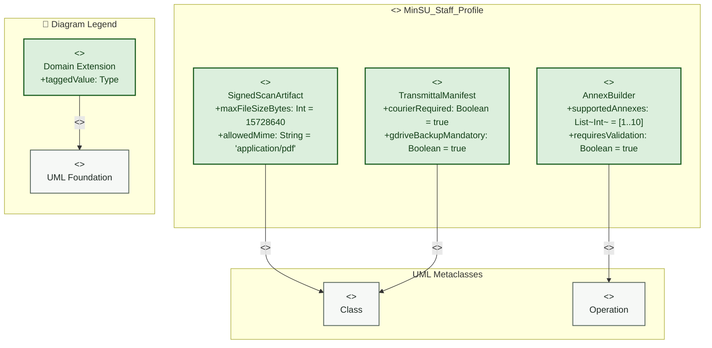

# Staff Coordinator — Profile Diagram

> **Role:** `STAFF`  
> **Diagram Type:** Profile Diagram  
> **Target Domain:** Annex Operations & Transmittal Tracking

---

## 1. Purpose

The Profile Diagram defines domain-specific UML extensions for Staff operational management, including scan artifact properties, transmittal manifests, and call form builders.

---

## 2. Mermaid Profile Diagram



---

## 3. Diagram Legend & Symbol Guide

| Visual Symbol | Syntax / Style | UML Profile Mechanism | MinSU Governance Application |
|---|---|---|---|
| `<<metaclass>>` Box | `fill:#F6F8F6, stroke:#55645B` | Core UML base meta-element | Standard UML `Class` or `Component` |
| `<<stereotype>>` Box | `fill:#DCEFDD, stroke:#1B5E20` | Domain-specific extension | `<<TDPAnnex>>`, `<<FinancialAnnex>>`, `<<AuditedEntity>>`, `<<ExecutiveReviewable>>` |
| `+taggedValue: Type` | Tagged Value Attribute | Metadata property attached to stereotype | `annexNumber`, `signatoryRole`, `slaHours = 48`, `requiresDisbursementCheck` |
| `-- "<<extension>>" -->` | Extension Relationship | Extends metaclass semantics | Connects custom TDP stereotype to standard UML metaclass |
| `-- "<<generalization>>" -->` | Specialization Hierarchy | Stereotype inheritance | `FinancialAnnex` inherits all properties of `TDPAnnex` |


---

## 4. PlantUML Profile Diagram

```plantuml
@startuml
skinparam packageBackgroundColor #FFFFFF
skinparam packageBorderColor #1B5E20

package "<<profile>> MinSU_Staff_Profile" {
  class "Class" <<metaclass>> as MetaClass
  class "Operation" <<metaclass>> as MetaOp

  class "AnnexBuilder" <<stereotype>> {
    + supportedAnnexes : List<Integer> = [1..10]
    + requiresValidation : Boolean = true
  }

  class "SignedScanArtifact" <<stereotype>> {
    + maxFileSizeBytes : Integer = 15728640
    + allowedMime : String = "application/pdf"
  }

  class "TransmittalManifest" <<stereotype>> {
    + courierRequired : Boolean = true
    + gdriveBackupMandatory : Boolean = true
  }

  AnnexBuilder -up-> MetaOp : "<<extension>>"
  SignedScanArtifact -up-> MetaClass : "<<extension>>"
  TransmittalManifest -up-> MetaClass : "<<extension>>"
}
@enduml
```

---

## 5. Stereotype Definitions

| Stereotype | Metaclass | Tagged Values | Description |
|---|---|---|---|
| `<<AnnexBuilder>>` | `Operation` | `supportedAnnexes: List`, `requiresValidation: Boolean` | Flags form compilation methods for Annexes 1 through 10. |
| `<<SignedScanArtifact>>` | `Class` | `maxFileSizeBytes: Int`, `allowedMime: String` | Constrains physical document scans to PDF under 15MB. |
| `<<TransmittalManifest>>` | `Class` | `courierRequired: Boolean`, `gdriveBackupMandatory: Boolean` | Mandates courier airway bill logging and Google Drive backup URLs. |
