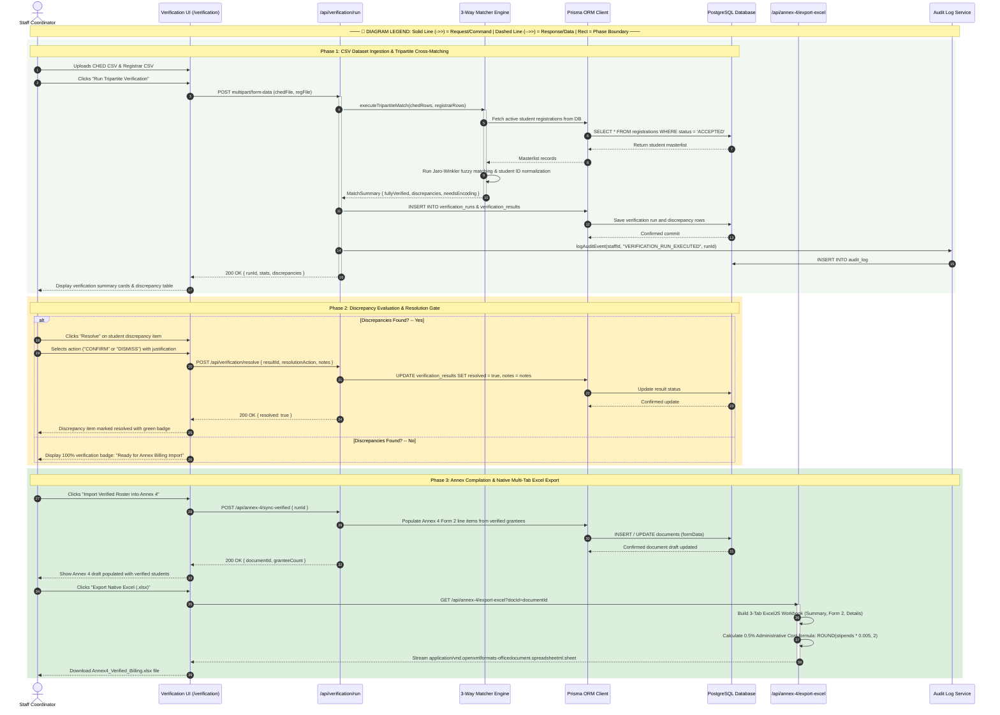

# Staff Coordinator — Sequence Diagram

> **Role:** `STAFF`  
> **Diagram Type:** Sequence Diagram  
> **Scenario:** 3-Way Tripartite Verification & Native Excel Export  
> **Standard:** UML 2.5 Sequence Specification

---

## 1. Purpose

The Sequence Diagram shows the chronological message flow when the Staff Coordinator executes a 3-way cross-matching run, resolves student discrepancies, imports verified grantees into Annex 4, and exports the native Excel workbook.

---

## 2. Mermaid Sequence Diagram

---

## 3. Diagram Legend & Symbol Guide

| Visual / Symbol | Element Type | Technical Role | MinSU DocTrack Context |
|---|---|---|---|
| `Actor` | Human User | Initiator of operational procedures | Staff Coordinator executing verification runs |
| `Participant` | System Component | Boundary, controller, or data store | Verification API, 3-Way Matcher Engine, Prisma ORM |
| `->>` | Synchronous Message | Command or method invocation | Upload CSV files, run matching, resolve discrepancy |
| `-->>` | Return Message | Response data or confirmation payload | Returns summary metrics, discrepancy lists, streamed Excel file |
| `alt / else` | Conditional Frame | Guarded execution path (**Yes** / **No**) | Discrepancies Found? Yes -> manual resolution; No -> instant ready |
| `rect` | Grouping Boundary | Multi-step logical operational phase | Ingestion phase, discrepancy gate, compilation and export |

---

## 4. Execution Sequence Steps

1. Staff Coordinator uploads CHED and Registrar CSV datasets to `/verification`.
2. Staff clicks "Run Tripartite Verification".
3. System normalizes student IDs and applies Jaro-Winkler fuzzy name matching.
4. If discrepancies exist (**Yes**), Staff inspects items and manually resolves them.
5. If zero discrepancies exist (**No**), System marks the cohort ready for billing.
6. Staff clicks "Import Verified Roster into Annex 4".
7. System generates the Form 2 student grantee table.
8. Staff clicks "Export Native Excel".
9. System generates and streams a native 3-tab `ExcelJS` spreadsheet with automated fiscal formulas.
