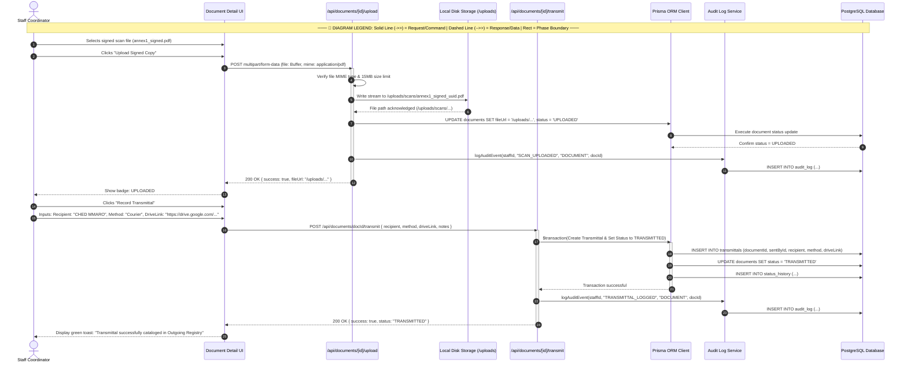

# Staff Coordinator — Sequence Diagram

> **Role:** `STAFF`  
> **Diagram Type:** Sequence Diagram  
> **Scenario:** Signed Scan Upload & Transmittal Registration

---

## 1. Purpose

The Sequence Diagram shows the messages exchanged when the Staff Coordinator uploads a wet-signed PDF scan and registers the outgoing transmittal to CHED.

---

## 2. Mermaid Sequence Diagram

---

## 3. Diagram Legend & Symbol Guide

| Visual / Symbol | Element Type | Technical Role | MinSU DocTrack Context |
|---|---|---|---|
| 👤 `actor` | Human Actor | External user role triggering system operations | Student Applicant, Staff Coordinator, Campus Director, Accounting Officer |
| 🔲 `participant` | System Component | Internal software subsystem or persistence boundary | Web UI, API Endpoint, Workflow Engine, Prisma/PostgreSQL, PDF Compiler |
| ──▶ `->>` | Solid Arrow | Synchronous invocation or command message | Submitting forms, verifying tokens, invoking database writes |
| - - ▷ `-->>` | Dashed Arrow | Return response or data payload | Confirmation slips, tracking codes, PDF binary buffers, query results |
| 🔲 `activate / deactivate` | Activation Lifeline | Period during which a component executes logic | Active request execution on API controllers or PDF engines |
| 🔲 `alt / else` | Conditional Fragment | Decision tree handling alternative workflow paths | Approval vs. Return branching, SLA compliance checks |

---

## 4. Sequence Steps

1. Staff uploads the scanned PDF via the document detail screen.
2. API validates file type and streams binary data to local `/uploads` storage.
3. Database marks the document as `UPLOADED`.
4. Staff enters courier tracking information and the external Google Drive link.
5. API creates a `Transmittal` record and marks the document `TRANSMITTED`.
6. Audit Log Service stores the dispatch event, and the Outgoing Registry updates.
