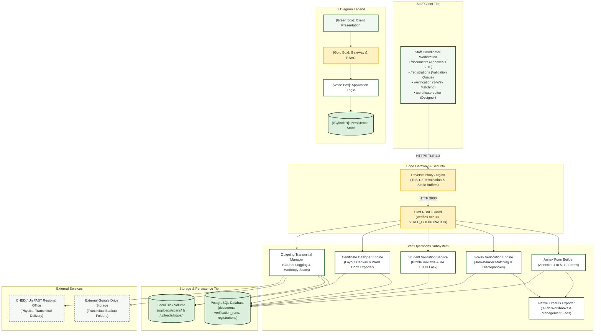

# Staff Coordinator — System Architecture Diagram

> **Role:** `STAFF`  
> **Diagram Type:** System Architecture Diagram  
> **Focus:** Operations Subsystem, 3-Way Matcher, Validation Queue, and Certificate Designer

---

## 1. Purpose

The System Architecture Diagram shows the multi-tier architecture used by the Staff Coordinator, including client interfaces, edge routing, application services, persistence layers, and external agency links.

---

## 2. Mermaid System Architecture Diagram

---

## 3. Diagram Legend & Symbol Guide

| Visual Symbol | Syntax / Style | Tier Concept | MinSU Implementation |
|---|---|---|---|
| Client Tier | `#F1F8F1` Box | User Workstation Presentation | Next.js browser views for staff operations |
| Edge Tier | `#FFF1C2` Box | Gateway & Authorization | Reverse proxy and `StaffRBAC` token validator |
| Application Tier | `#FFFFFF` Box | Domain Services | 3-Way Matcher, ExcelJS exporter, Word docx engine |
| Persistence Tier | Cylinder Shape | Relational & Disk Storage | PostgreSQL database and host-mounted uploads volume |

---

## 4. Tier Responsibilities

- **Client Tier**: Delivers responsive forms, interactive discrepancy tables, and drag-and-drop certificate signatory editors.
- **Edge Tier**: Blocks unauthenticated requests and restricts execution strictly to `STAFF_COORDINATOR` sessions.
- **Application Tier**: Processes multipart CSV uploads, executes cross-matching algorithms, and compiles Annex billing statements.
- **Persistence Tier**: Ensures ACID compliance for registration records and saves wet-signed PDF scans.
