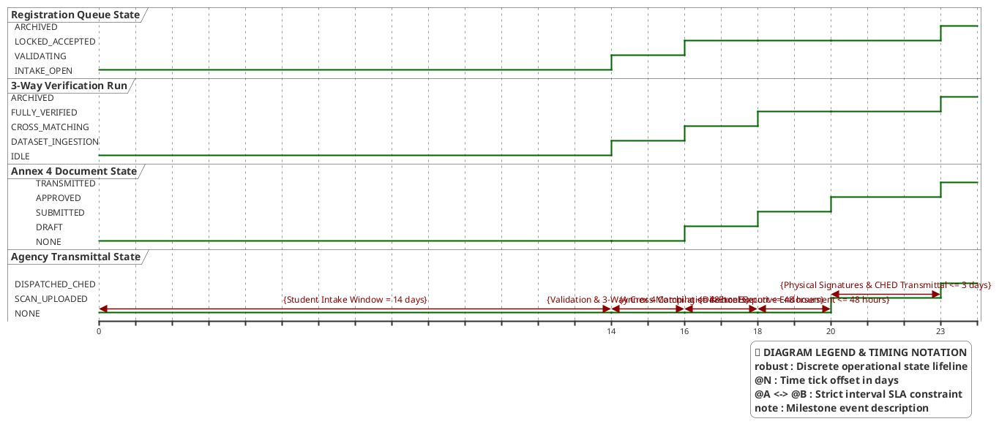

# Staff Coordinator — Timing Diagram

> **Role:** `STAFF`  
> **Diagram Type:** Timing Diagram  
> **Scenario:** Student Intake, 3-Way Verification, Annex 4 Compilation, and Transmittal Milestones  
> **Standard:** UML 2.5 Timing Specification

---

## 1. Purpose

The Timing Diagram shows the lifecycle state transitions and strict duration constraints across the Staff Coordinator timeline: student intake validation, 3-way tripartite verification, Annex 4 compilation, and agency transmittal dispatch.

---

## 2. PlantUML Timing Diagram

---

## 3. Diagram Legend & Symbol Guide

| Visual Symbol | Syntax / Style | UML Timing Concept | MinSU Implementation Context |
|---|---|---|---|
| Lifeline Wave | `robust "Name"` | Continuous state value of a domain entity | Registration Queue, Verification Run, Annex Document, Transmittal |
| State Label | `Lifeline is STATE` | Active discrete status during interval | `INTAKE_OPEN`, `CROSS_MATCHING`, `LOCKED_ACCEPTED` |
| Time Constraint | `@A <-> @B : {Label}` | Enforced operational deadline (SLA) | 48h verification SLA, 14-day registration window |
| Milestone Note | `note bottom of Lifeline` | Significant regulatory or operational event | Intake cutoff, Director endorsement, CHED dispatch |

---

## 4. Timeline Milestones & Service Level Agreements

- **Day 0 to 14**: Student application window remains open in the portal.
- **Day 14 to 16**: Staff validates student profiles, locks identity under RA 10173, and runs tripartite cross-matching (48h max).
- **Day 16 to 18**: Verified students are imported into Annex 4 and submitted to the Campus Director with Excel exports.
- **Day 18 to 20**: Campus Director executes 1-click executive approval (48h review SLA).
- **Day 20 to 23**: Staff prints physical copies, obtains wet-ink signatures, uploads the stamped PDF scan, and dispatches the transmittal to CHED MMARO.
