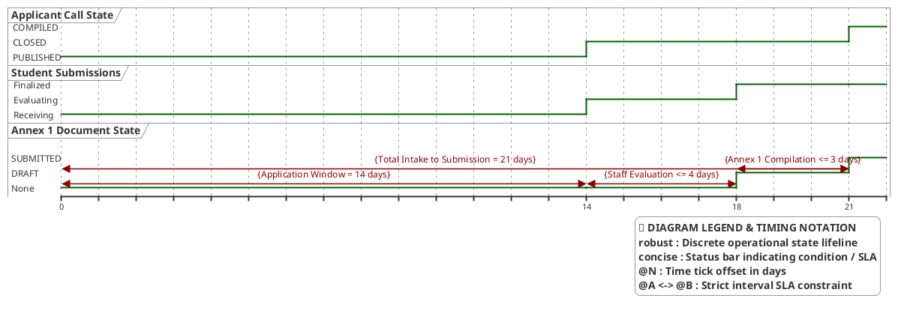

# Staff Coordinator — Timing Diagram

> **Role:** `STAFF`  
> **Diagram Type:** Timing Diagram  
> **Scenario:** Annex 2 Application Call Lifecycle & Annex 1 Compilation Milestones  
> **Standard:** UML 2.5 Timing Specification

---

## 1. Purpose

The Timing Diagram shows the lifecycle states of an Annex 2 applicant call, application evaluations, and the subsequent Annex 1 compilation schedule across semester deadlines.

---

## 2. PlantUML Timing Diagram

---

## 3. Diagram Legend & Symbol Guide

| Notation / Element | Type / Syntax | Temporal Role | MinSU Operational Application |
|---|---|---|---|
| `robust "Lifeline"` | Discrete State Lifeline | Tracks operational state transitions over time | `CallState` (Applicant Call), `AppsState` (Submissions), `Annex1State` (Compilation) |
| `@N` | Time Tick Offset | Calendar day or elapsed duration marker | `@0` (Publication), `@14` (Intake cutoff), `@21` (Executive submission) |
| `@A <-> @B : {Rule}` | Time Constraint Interval | Hard institutional deadline or turnaround window | 14-day student intake window, 4-day staff evaluation, 3-day Annex 1 compile |
| `note bottom of ...` | Event Milestone Callout | Operational trigger annotation | Call deadline reached, accepted grantees compiled, director review ingress |

---

## 4. Timeline & Milestones Table

| Milestone | Time (Days) | Call State | Application State | Annex 1 State | Constraint |
|---|---|---|---|---|---|
| **Call Publication** | `T + 0d` | `PUBLISHED` | `Receiving` | `None` | Open portal accepting applications. |
| **Call Deadline** | `T + 14d` | `CLOSED` | `Evaluating` | `None` | Applications close; staff evaluates proofs. |
| **Grantees Selected** | `T + 18d` | `CLOSED` | `Finalized` | `DRAFT` | Staff accepts qualified student records. |
| **Annex 1 Submitted** | `T + 21d` | `COMPILED` | `Finalized` | `SUBMITTED` | Master list submitted for executive endorsement. |
