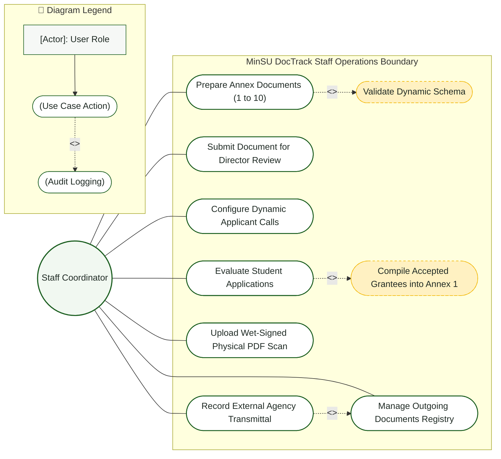
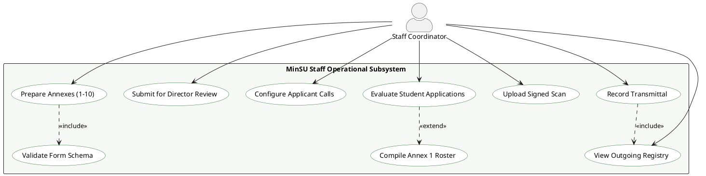

# Staff Coordinator — Use Case Diagram

> **Role:** `STAFF`  
> **Diagram Type:** Use Case Diagram  
> **Standard:** UML 2.5 Use Case Specification

---

## 1. Purpose

The Use Case Diagram shows all primary operational goals of the Staff Coordinator, including document preparation, call management, application evaluation, and transmittal logging.

---

## 2. Mermaid Use Case Diagram

---

## 3. Diagram Legend & Symbol Guide

| Visual Symbol | Syntax / Style | UML Use Case Concept | MinSU System Implementation |
|---|---|---|---|
| `actor` / `[Actor]` | External Role | User or external system triggering use cases | Student, Staff Coordinator, Campus Director, Accounting, Admin, CHED Agency |
| `usecase` / `(["(Action)"])` | Use Case Unit | Distinct capability or user goal | Browse Calls, Submit Application, 1-Click Endorsement, Reconcile Financials |
| `-->` Solid Arrow | Actor Association | User initiates or receives data from the use case | Student initiates application, Director approves, Staff dispatches |
| `..>` / `-.->` Dashed Arrow | Stereotyped Dependency | Relationship between two use cases | `<<include>>` (Mandatory invocation) or `<<extend>>` (Optional augmentation) |
| `<<include>>` | Mandatory Inclusion | Always executed as part of base use case | Every mutation includes `Record Immutable Audit Log` & `Authenticate` |
| `<<extend>>` | Optional Extension | Conditionally extends base use case | Payroll compilation optionally triggers `Export Printable PDF` |

---

## 4. PlantUML Use Case Diagram

---

## 5. Use Case Specifications

- **Prepare Annex Documents**: Staff enters student names, scholarship grants, and academic terms into form builders.
- **Configure Applicant Calls**: Staff defines eligibility guidelines, deadlines, and dynamic form fields for online applicants.
- **Evaluate Student Applications**: Staff verifies student uploaded CORs, grades, and indigency certificates.
- **Upload Wet-Signed Physical PDF Scan**: Staff uploads the approved, wet-ink signed, and university-stamped hardcopy.
- **Record External Agency Transmittal**: Staff logs delivery date, recipient (CHED/UniFAST), courier details, and Google Drive links.
