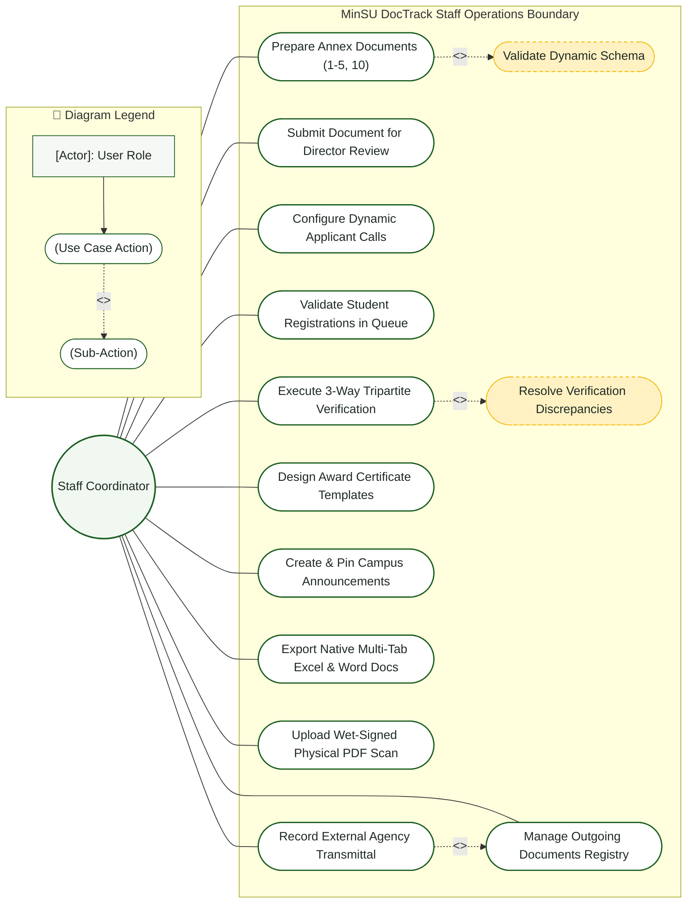
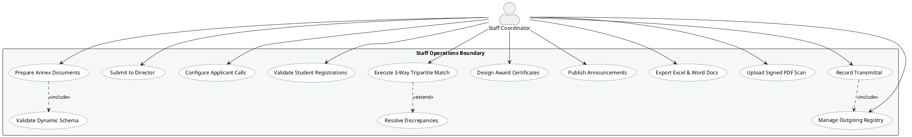

# Staff Coordinator — Use Case Diagram

> **Role:** `STAFF`  
> **Diagram Type:** Use Case Diagram  
> **Standard:** UML 2.5 Use Case Specification

---

## 1. Purpose

The Use Case Diagram shows all primary operational goals of the Staff Coordinator, including document preparation, student validation, 3-way verification, certificate design, call management, announcements, and transmittal logging.

---

## 2. Mermaid Use Case Diagram

---

## 3. Diagram Legend & Symbol Guide

| Visual Symbol | Syntax / Style | UML Use Case Concept | MinSU System Implementation |
|---|---|---|---|
| `actor` / `[Actor]` | External Role | Operational user executing tasks | Staff Coordinator |
| `usecase` / `(["(Action)"])` | Use Case Unit | Operational goal or procedure | Validate Registrations, Execute 3-Way Match, Design Certificates, Prepare Annex |
| `-->` Solid Arrow | Actor Association | User initiates action | Staff prepares annexes, uploads CSVs, configures calls |
| `..>` / `-.->` Dashed Arrow | Stereotyped Dependency | Relationship between use cases | `<<include>>` (Mandatory validation) or `<<extend>>` (Discrepancy resolution) |

---

## 4. PlantUML Use Case Diagram

