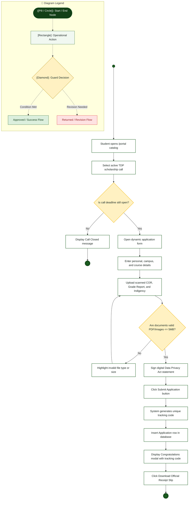

# Student Applicant — Activity Diagram

> **Role:** `STUDENT`  
> **Diagram Type:** Activity Diagram  
> **Workflow:** Online Scholarship Application & Verification

---

## 1. Purpose

The Activity Diagram shows the step-by-step workflow for a student applying for a TDP scholarship, uploading required documents, and receiving a verified tracking code.

---

## 2. Mermaid Activity Diagram

---

## 3. Diagram Legend & Symbol Guide

| Visual Symbol | Syntax / Node Type | Technical Role | MinSU Domain Meaning |
|---|---|---|---|
| `([Pill / Circle])` | `([Start / End])` / `(( ))` | Initial or terminal workflow boundary | Workflow entry point, queue initiation, terminal archive closure |
| `[Rectangle]` | `["Action"]` | Operational task or software routine | Inspecting forms, computing sums, generating receipt, updating status |
| `{Diamond}` | `{"Decision"}` | Mutually exclusive condition / guard | "Compliance verified?", "Variance == 0.00?", "Quota available?" |
| `──▶` | Solid Line `-->` | Sequential flow transition | Standard forward progression between operational activities |
| `-->|Label|` | Guarded Branch | Conditional execution path | "Yes / Approved", "No / Return with Remarks" |
| 🔲 Subgraph | `subgraph Lane` | Departmental Swimlane Boundary | Segregates duties across roles and authority boundaries |
| 🟢 Green Tone | `#DCEFDD` / `#1B5E20` | Approved State / Forward Flow | Validated submissions, executive approvals, zero-variance checks |
| 🟡 Gold Tone | `#FFF1C2` / `#B88A00` | Evaluation / Inspection Gate | Review queues, quota verification, decision checkpoints |
| 🔴 Red / Rose Tone | `#FEE2E2` / `#DC2626` | Return / Discrepancy Alert | Ineligible applications, returned documents, ledger adjustments |

---

## 4. Workflow Steps

1. Student browses open scholarship calls on `/portal`.
2. Student selects an active TDP announcement.
3. System verifies that the submission deadline has not passed.
4. Student enters demographic and academic details into the dynamic form.
5. Student attaches Certificate of Registration (COR) and grade transcripts.
6. System checks file types (PDF, PNG, JPG) and sizes (`<= 5MB`).
7. Student agrees to the Data Privacy Act (RA 10173) consent clause.
8. System assigns an alphanumeric tracking code (for example, `TDP-2026-X9B2`).
9. System stores the submission with status `SUBMITTED`.
10. Student receives an official downloadable receipt slip.
