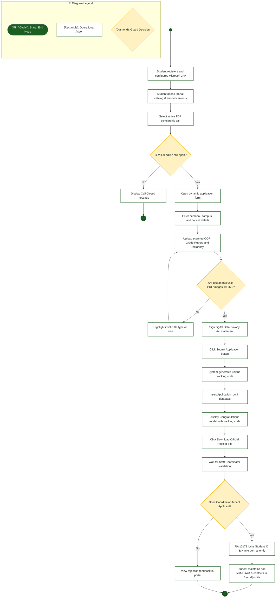
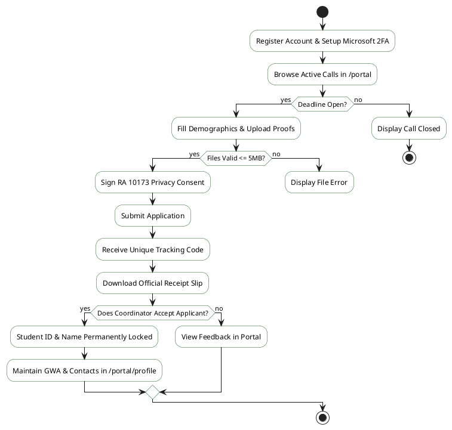

# Student Applicant — Activity Diagram

> **Role:** `STUDENT`  
> **Diagram Type:** Activity Diagram  
> **Workflow:** 2FA Setup, Online Scholarship Application & Profile Maintenance

---

## 1. Purpose

The Activity Diagram shows the step-by-step workflow for a student setting up 2FA, applying for a TDP scholarship, uploading required documents, receiving a verified tracking code, and maintaining profile records under RA 10173 data locks.

---

## 2. Mermaid Activity Diagram

---

## 3. Diagram Legend & Symbol Guide

| Visual Symbol | Syntax / Style | UML Activity Concept | MinSU System Implementation |
|---|---|---|---|
| `Start / End` | `(( ))` / `((( )))` | Initial / Final State | Student lifecycle starts at 2FA registration and concludes at profile maintenance |
| `Action` | `[Rectangle]` | Operational Step | Setup 2FA, Upload Proofs, Generate Tracking Code, Maintain Profile |
| `Decision` | `{Diamond}` | Guard Evaluation | Deadline Open?, Valid Files?, Coordinator Acceptance Decision? |

---

## 4. PlantUML Activity Diagram

