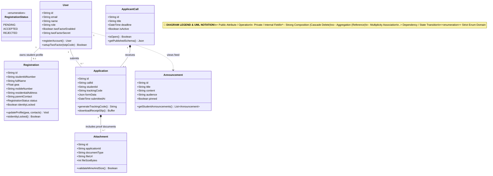

# Student Applicant — Class Diagram

> **Role:** `STUDENT`  
> **Diagram Type:** Class Diagram  
> **Standard:** UML 2.5 Class Specification

---

## 1. Purpose

The Class Diagram shows the domain models, attributes, operations, and relationships governing student online applications, Microsoft Authenticator 2FA, RA 10173 identity locks, tracking code lookups, and announcement feeds.

---

## 2. Mermaid Class Diagram

---

## 3. Diagram Legend & Symbol Guide

| Symbol / UML Notation | Meaning & Syntax | Technical Function | MinSU Domain Example |
|---|---|---|---|
| `+` | Public Visibility | Readable attribute or callable method | `+generateTrackingCode()`, `+updateProfile()` |
| `-` | Private Visibility | Encapsulated field | `twoFactorSecret`, session hashes |
| `<<enumeration>>` | Enum Classifier | Strict closed set of categorical values | `RegistrationStatus` (`PENDING`, `ACCEPTED`, `REJECTED`) |
| `*--` | Strong Composition | Lifecycle containment (child deleted on parent deletion) | `Application *-- Attachment` |
| `--` | Multiplicity Association | Association relationship between classes | One student user owns one official registration profile |

---

## 4. Operations & Domain Rules

- `isIdentityLocked()` returns true when an applicant is marked `ACCEPTED`, permanently preventing modification of `studentIdNumber` and `fullName` under RA 10173.
- `updateProfile()` permits students to maintain dynamic attributes (GWA, residential address, mobile number, parent contacts).
- `generateTrackingCode()` creates a unique 12-character lookup identifier formatted as `TDP-YYYY-XXXX`.
- `validateMimeAndSize()` restricts document attachments strictly to PDF or image files 5 MB or smaller.
