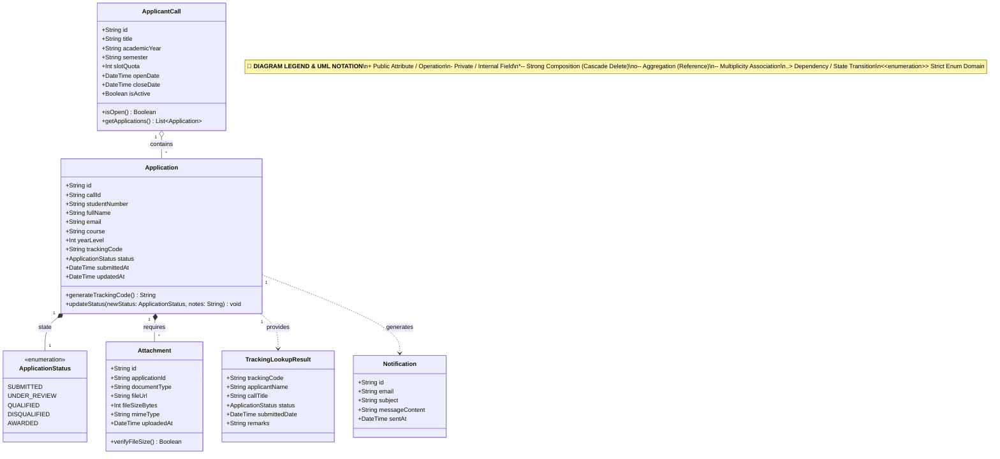

# Class Diagram: Student Applicant Domain

## 1. Description
This class diagram details the object-oriented data structures, enums, attributes, and associations supporting scholarship application submissions, document verifications, and applicant tracking.

## 2. ASD-STE100 Technical Specifications
- Define unique tracking codes for every scholarship application record.
- Associate applications with an active applicant call cycle.
- Link applicant records optionally with a registered user entity.
- Store file attachments with verified file hashes and MIME types.

## 3. Class Diagram (Mermaid)

---

## 4. Diagram Legend & Symbol Guide

| Symbol / UML Notation | Meaning & Syntax | Technical Function | MinSU Domain Example |
|---|---|---|---|
| `+` | Public Visibility | Readable attribute or callable method | `+id`, `+title`, `+submitDocument()`, `+validateZeroVariance()` |
| `-` | Private Visibility | Encapsulated field | Password hashes, system flags, sensitive session tokens |
| `<<enumeration>>` | Enum Classifier | Strict closed set of categorical values | `Role` (`DIRECTOR`, `STAFF`), `DocumentStatus` (`APPROVED`, `SUBMITTED`) |
| `*--` | Strong Composition | Lifecycle containment (child deleted on parent deletion) | `Document *-- StatusHistory`, `Document *-- Comment` |
| `o--` | Weak Aggregation | Referenced association without ownership | `Document o-- User` (Document references author) |
| `--` | Association (`"1" -- "*"`) | Multiplicity mapping between database entities | One user creates many documents or receives notifications |
| `..>` | Dependency | Usage or transition relationship | Domain model transitioning document lifecycle states |

## 5. Class Responsibilities
- **ApplicantCall**: Represents an administrative call for scholarship applicants under Annex 2.
- **Application**: The core entity storing student personal data, academic standing, and submission status.
- **Attachment**: Represents uploaded evidence files (Certificate of Registration, Grades Slip, Certificate of Indigency).
- **TrackingLookupResult**: DTO returned to students searching by tracking code in the public portal.
