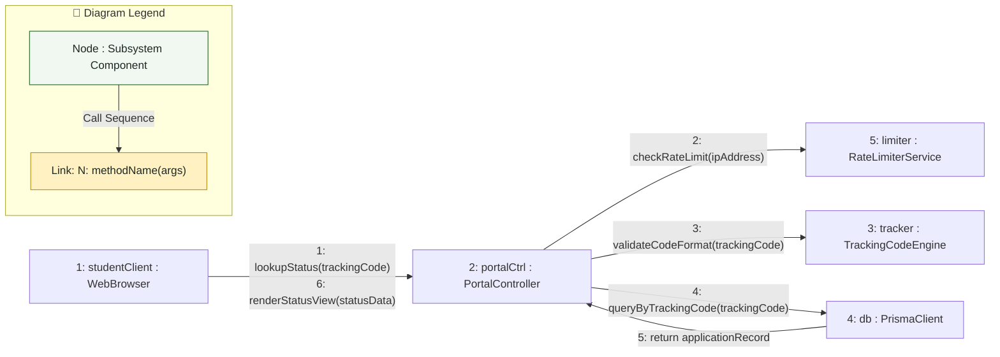

# Communication Diagram: Student Applicant Domain

## 1. Description
This communication diagram visualizes the structural links and sequenced messages exchanged between collaborating objects when a student queries their application status using a tracking code.

## 2. ASD-STE100 Technical Specifications
- Order messages with sequential numbers to show invocation order.
- Connect collaborating instances through explicit structural paths.
- Enforce public lookup constraints without exposing sensitive internal remarks.

## 3. Communication Diagram (Mermaid)

---

## 4. Diagram Legend & Symbol Guide

| Element | Format / Syntax | Technical Meaning | MinSU Implementation Context |
|---|---|---|---|
| Subsystem Node | `[N: name : Class]` | Structural software participant | Controllers, Workflow Engines, Prisma Client, Storage Adapters |
| Link Connector | `-- "..." -->` | Directed communication channel | HTTP request, RPC method call, or database query |
| Numbered Prefix | `1:`, `2:`, `10:` | Chronological message sequence number | Sequential execution order from client event to persistence and UI update |
| Method Signature | `methodName(params)` | Invoked operation contract | `verifyRole(token)`, `checkVariance()`, `writeAuditLog()` |
| 🟢 Green Tone | `#F1F8F1` / `#1B5E20` | Core Subsystem Component | Institutional controllers, persistence adapters, and business engines |
| 🟡 Gold Tone | `#FFF1C2` / `#B88A00` | Guard & Dispatch Relay | Access guards, validation checks, and notification dispatchers |

## 5. Message Sequence Steps
- **1**: The student enters their tracking code (e.g., `TDP-2026-0042`) into the lookup form on the web portal.
- **2**: The portal controller checks the client IP address against the rate limiter to prevent automated scraping.
- **3**: The tracking code engine verifies the code conforms to the standard regular expression format.
- **4-5**: The database client executes a parameterized query to locate the matching application record.
- **6**: The portal controller formats the status timeline and renders the progress card to the student.
