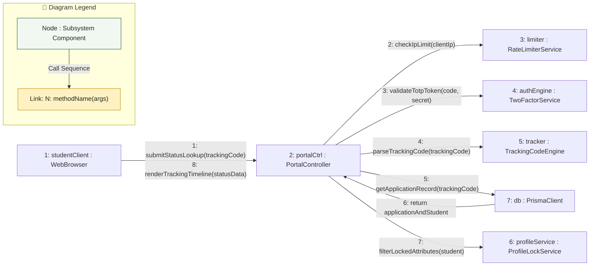

# Student Applicant — Communication Diagram

> **Role:** `STUDENT`  
> **Diagram Type:** Communication Diagram  
> **Scenario:** Student Authentication, Tracking Lookup & Application Submission Collaborations  
> **Standard:** UML 2.5 Communication Specification

---

## 1. Purpose

The Communication Diagram shows the structural links and sequenced messages exchanged between collaborating software instances when a student authenticates with 2FA, queries application status via tracking code, or accesses locked profile details in MinSU DocTrack.

---

## 2. Mermaid Communication Diagram

---

## 3. Diagram Legend & Symbol Guide

| Element | Format / Syntax | Technical Meaning | MinSU Implementation Context |
|---|---|---|---|
| Subsystem Node | `[N: name : Class]` | Structural software participant | Controllers, 2FA Services, Tracking Engine, Prisma Client |
| Link Connector | `-- "..." -->` | Directed communication channel | HTTP request, RPC method call, or database query |
| Numbered Prefix | `1:`, `2:`, `8:` | Chronological message sequence number | Execution order from client trigger to persistence and view update |
| Method Signature | `methodName(params)` | Invoked operation contract | `validateTotpToken()`, `checkIpLimit()`, `parseTrackingCode()` |
| 🟢 Green Tone | `#F1F8F1` / `#1B5E20` | Core Subsystem Component | Portal controllers, database clients, profile services |
| 🟡 Gold Tone | `#FFF1C2` / `#B88A00` | Security & Dispatch Guard | Rate limiters, TOTP engines, and tracking resolvers |

---

## 4. Message Sequence Steps

1. **Step 1**: The student enters their tracking code (`TDP-YYYY-XXXX`) or requests their profile status from the portal web UI.
2. **Step 2**: `PortalController` requests client IP evaluation from `RateLimiterService` to prevent scraping and automated enumeration.
3. **Step 3**: For authenticated actions, `TwoFactorService` validates the 6-digit TOTP code against the student's stored secret.
4. **Step 4**: `TrackingCodeEngine` validates the code structure using regular expressions.
5. **Step 5**: `PrismaClient` executes an indexed query against the PostgreSQL database to retrieve the application and student records.
6. **Step 6**: The database returns the matching entities.
7. **Step 7**: `ProfileLockService` masks locked identity fields (Student ID Number and Legal Name) if the applicant is an accepted scholar.
8. **Step 8**: `PortalController` formats the public timeline and renders the progress card to the student browser.
