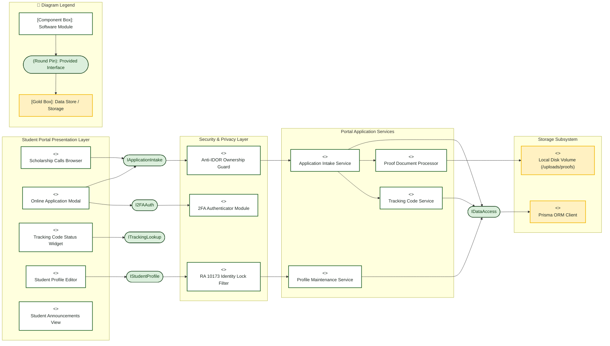

# Student Applicant — Component Diagram

> **Role:** `STUDENT`  
> **Diagram Type:** Component Diagram  
> **Standard:** UML 2.5 Component Specification

---

## 1. Purpose

The Component Diagram shows the software components, provided interfaces, and required dependencies within the student portal subsystem, supporting scholarship applications, 2FA authentication, RA 10173 profile locks, tracking lookups, and announcement feeds.

---

## 2. Mermaid Component Diagram

---

## 3. Diagram Legend & Symbol Guide

| Visual Symbol | Syntax / Style | UML Component Meaning | MinSU Implementation |
|---|---|---|---|
| `[Component]` | `["<<component>>\nName"]` | Autonomous modular unit with internal logic | Application Intake Service, 2FA Authenticator, Identity Lock Filter |
| `(Interface)` | `(["IName"])` | Formal contract or API boundary | `I2FAAuth`, `IApplicationIntake`, `ITrackingLookup` |
| `Solid Arrow` | `-->` | Direct dependency or invocation | Portal views invoke application and tracking services |
| `Data Component` | Gold Tone `#FFF1C2` | Persistence or storage component | Prisma client and uploaded applicant proofs storage |

---

## 4. Component Responsibilities

- **Online Application Modal (`ApplyFormUI`)**: Guides student through biodata entry, dynamic call requirements, and proof attachments.
- **RA 10173 Identity Lock Filter (`IdentityLocker`)**: Enforces that `studentIdNumber` and `fullName` are read-only once accepted, while allowing GWA and contact updates.
- **2FA Authenticator Module (`TwoFactorModule`)**: Validates Microsoft Authenticator TOTP codes before permitting session access.
- **Tracking Code Service (`TrackerService`)**: Issues cryptographically secure identifiers (`TDP-YYYY-XXXX`) and returns public evaluation progress.
