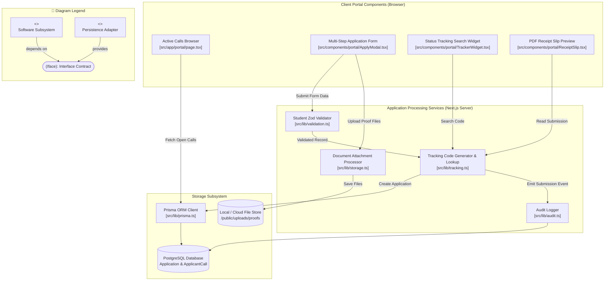

# Component Diagram: Student Applicant Domain

## 1. Description
This component diagram models the modular software components involved in the public student portal. It shows the client-side intake forms, tracking widgets, validation filters, file upload processors, and database adapters.

## 2. ASD-STE100 Technical Specifications
- Isolate public portal components from privileged administrative dashboards.
- Process file attachments through a client-side size and MIME pre-check filter.
- Route tracking code inquiries through rate-limited query handlers.
- Persist completed application packets inside relational and object stores.

## 3. Component Diagram (Mermaid)

---

## 4. Diagram Legend & Symbol Guide

| Visual Symbol | Syntax / Style | Technical Role | MinSU Architecture Mapping |
|---|---|---|---|
| `<<component>>` Box | `fill:#FFFFFF, stroke:#1B5E20` | Architectural subsystem or service module | Views, Controllers, Auth Services, Document Engines |
| `([Interface Circle])` | `fill:#DCEFDD, stroke:#123F17` | Provided / Required Interface Contract | `IAuthSession`, `IRBACGuard`, `IDocumentWorkflow`, `IDataAccess` |
| 🟨 Data Component | `fill:#FFF1C2, stroke:#F2B705` | Persistence & Storage adapter component | Prisma ORM Client, Local Storage Volume, Google Drive Client |
| `-->` Solid Arrow | Dependency / Consumer | Module calls or requires the interface | View components requiring workflow and auth interfaces |
| `-- provides -->` | Realization / Provider | Module implements or provides the interface | Service layer realizing database or workflow contracts |
| Boundary Subgraph | `subgraph LAYER` | Architectural tier / layer grouping | Presentation, Security, Domain Logic, and Persistence Layers |

## 5. Component Interfaces
- **Multi-Step Application Form**: Collects applicant identity, demographic information, and scanned requirements.
- **Student Zod Validator**: Verifies valid student ID formats, campus enrollment, and file upload limits.
- **Tracking Code Generator & Lookup**: Produces formatted codes (`TDP-2026-XXXX`) and resolves applicant status.
- **Document Attachment Processor**: Validates MIME types (PDF, PNG, JPG) and enforces 5MB ceilings.
