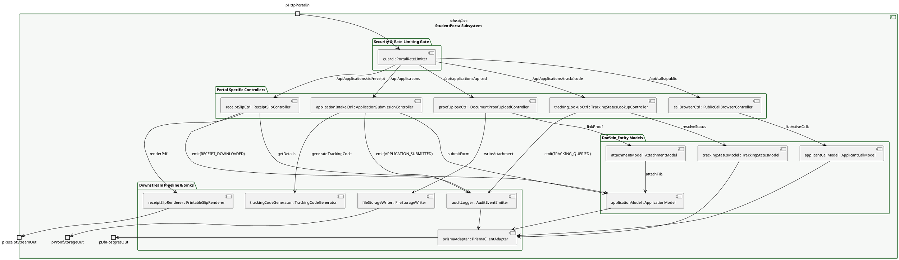

# Composite Structure Diagram: Student Applicant Domain

> **Role:** `STUDENT` (Public Scholarship Portal & Applicant)  
> **Diagram Type:** Composite Structure Diagram  
> **Classifier:** `StudentPortalSubsystem`

---

## 1. Purpose

This Composite Structure Diagram depicts the internal architecture of the `StudentPortalSubsystem`. It illustrates how public student requests pass through the portal rate limiter and input sanitization gate, how specialized controllers manage call browsing, application intake, proof uploads, tracking lookups, and receipt generation, how controllers connect to in-memory domain models, and where data moves downstream to cryptographic code generators, physical attachment writers, slip renderers, and database persistence.

---

## 2. Mermaid Composite Structure Diagram

```mermaid
flowchart TB
    %% Styling Classes
    classDef classifierStyle fill:#F6F8F6,stroke:#1B5E20,stroke-width:2.5px,color:#1F2A24
    classDef portStyle fill:#FFF1C2,stroke:#F2B705,stroke-width:2px,color:#1F2A24
    classDef guardStyle fill:#F1F8F1,stroke:#1B5E20,stroke-width:1.5px,color:#123F17
    classDef ctrlStyle fill:#EFF6FF,stroke:#2563EB,stroke-width:1.5px,color:#1E3A8A
    classDef modelStyle fill:#FAF5FF,stroke:#9333EA,stroke-width:1.5px,color:#581C87
    classDef svcStyle fill:#FEFCE8,stroke:#CA8A04,stroke-width:1.5px,color:#713F12
    classDef adapterStyle fill:#DCEFDD,stroke:#164D1C,stroke-width:2px,color:#123F17

    subgraph SUBSYSTEM["«classifier» StudentPortalSubsystem"]
        direction TB

        %% Boundary Ingress Port
        pHttpPortalIn["Port: pHttpPortalIn<br/>(Public Web Requests / Form Posts)"]:::portStyle

        %% Layer 1: Security & Rate Limiting Gate
        subgraph LAYER_SECURITY ["Security & Rate Limiting Gate"]
            guard["guard : PortalRateLimiter<br/>• verifyIpRateLimit(20 req/min)<br/>• sanitizeFormDataInput()<br/>• enforceCsrfProtection()"]:::guardStyle
        end

        %% Layer 2: Role Specific Controllers
        subgraph LAYER_CONTROLLERS ["Portal Specific Controllers"]
            callBrowserCtrl["callBrowserCtrl : PublicCallBrowserController<br/>• listActiveCalls()<br/>• getCallDetails()<br/>• verifyCallDeadline()"]:::ctrlStyle

            applicationIntakeCtrl["applicationIntakeCtrl : ApplicationSubmissionController<br/>• validateStudentEligibility()<br/>• verifyUniqueStudentNumber()<br/>• submitApplicationForm()"]:::ctrlStyle

            proofUploadCtrl["proofUploadCtrl : DocumentProofUploadController<br/>• validateMimeType(['pdf','jpg','png'])<br/>• enforceMaxFileSize(5MB)<br/>• sanitizeFileName()"]:::ctrlStyle

            trackingLookupCtrl["trackingLookupCtrl : TrackingStatusLookupController<br/>• resolveTrackingCode()<br/>• maskSensitivePII()<br/>• getMilestoneProgress()"]:::ctrlStyle

            receiptSlipCtrl["receiptSlipCtrl : ReceiptSlipController<br/>• generateConfirmationSlip()<br/>• renderQrVerificationCode()<br/>• streamPdfSlip()"]:::ctrlStyle
        end

        %% Layer 3: Domain Entity Models
        subgraph LAYER_MODELS ["Domain Entity Models"]
            applicantCallModel["applicantCallModel : ApplicantCallModel<br/>- id: String<br/>- title: String<br/>- deadline: DateTime<br/>- formSchema: Json<br/>- isActive: Boolean"]:::modelStyle

            applicationModel["applicationModel : ApplicationModel<br/>- id: String<br/>- callId: String<br/>- studentId: String<br/>- formData: Json<br/>- trackingCode: String<br/>- status: ApplicationStatus"]:::modelStyle

            attachmentModel["attachmentModel : AttachmentModel<br/>- id: String<br/>- applicationId: String<br/>- fileName: String<br/>- filePath: String<br/>- mimeType: String<br/>- fileSize: Int"]:::modelStyle

            trackingStatusModel["trackingStatusModel : TrackingStatusModel<br/>- trackingCode: String<br/>- currentStatus: ApplicationStatus<br/>- submittedAt: DateTime<br/>- reviewComment: String?"]:::modelStyle
        end

        %% Layer 4: Downstream Services & Persistence ("Where it goes after")
        subgraph LAYER_DOWNSTREAM ["Downstream Pipeline & Storage Sinks"]
            trackingCodeGenerator["trackingCodeGenerator : TrackingCodeGenerator<br/>• generateTrackingCode('TDP-YYYY-XXXX')<br/>• verifyCodeUniqueness()<br/>• computeHashChecksum()"]:::svcStyle

            fileStorageWriter["fileStorageWriter : FileStorageWriter<br/>• writeBufferToVolume()<br/>• encryptStoredFile()<br/>• returnSecureRelativePath()"]:::svcStyle

            receiptSlipRenderer["receiptSlipRenderer : PrintableSlipRenderer<br/>• compileHtmlTemplate()<br/>• embedVerificationQr()<br/>• renderPdfStream()"]:::svcStyle

            auditLogger["auditLogger : AuditEventEmitter<br/>• emit('APPLICATION_SUBMITTED')<br/>• emit('TRACKING_QUERIED')<br/>• emit('RECEIPT_DOWNLOADED')"]:::svcStyle

            prismaAdapter["prismaAdapter : PrismaClientAdapter<br/>• applicantCall.findMany()<br/>• application.create()<br/>• application.findUnique()<br/>• auditLog.create()"]:::adapterStyle
        end

        %% Boundary Egress Ports
        pDbPostgresOut["Port: pDbPostgresOut<br/>(PostgreSQL Connection Pool)"]:::portStyle
        pProofStorageOut["Port: pProofStorageOut<br/>(Local Encrypted File Volume)"]:::portStyle
        pReceiptStreamOut["Port: pReceiptStreamOut<br/>(Downloadable PDF Slip Stream)"]:::portStyle

        %% Connectors: Ingress to Gate
        pHttpPortalIn -->|"HTTPS /apply & /track"| guard

        %% Gate to Controllers
        guard -->|"GET /api/calls/public"| callBrowserCtrl
        guard -->|"POST /api/applications"| applicationIntakeCtrl
        guard -->|"POST /api/applications/upload"| proofUploadCtrl
        guard -->|"GET /api/applications/track/:code"| trackingLookupCtrl
        guard -->|"GET /api/applications/:id/receipt"| receiptSlipCtrl

        %% Controllers to Domain Models & Generators
        callBrowserCtrl -->|"Query active windows"| applicantCallModel

        applicationIntakeCtrl -->|"Request tracking code"| trackingCodeGenerator
        applicationIntakeCtrl -->|"Hydrate submission"| applicationModel

        proofUploadCtrl -->|"Stream file binary"| fileStorageWriter
        proofUploadCtrl -->|"Link proof metadata"| attachmentModel
        attachmentModel -->|"Attach to application"| applicationModel

        trackingLookupCtrl -->|"Query status by code"| trackingStatusModel
        trackingStatusModel -->|"Resolve application state"| applicationModel

        receiptSlipCtrl -->|"Fetch submission record"| applicationModel
        receiptSlipCtrl -->|"Compile slip document"| receiptSlipRenderer

        %% Models to Persistence Adapter
        applicantCallModel -->|"Fetch active calls"| prismaAdapter
        applicationModel -->|"Persist Application Entity"| prismaAdapter
        trackingStatusModel -->|"Query Status Record"| prismaAdapter

        %% Controllers to Downstream Emitters
        applicationIntakeCtrl -->|"Emit submission event"| auditLogger
        trackingLookupCtrl -->|"Emit lookup query event"| auditLogger
        receiptSlipCtrl -->|"Emit receipt generated event"| auditLogger

        %% Downstream Services to Ports
        fileStorageWriter -->|"Persist attachments on disk"| pProofStorageOut
        receiptSlipRenderer -->|"Stream PDF receipt file"| pReceiptStreamOut
        auditLogger -->|"Save audit log row"| prismaAdapter
        prismaAdapter -->|"SQL Transactions / Port 5432"| pDbPostgresOut
    end

    %% ─── 📌 VISUAL LEGEND ───
    subgraph LEGEND ["📌 Diagram Legend"]
        direction TB
        L_Class["<<classifier>><br/>Encapsulating Unit"]:::classifierStyle
        L_Port["Port: pName<br/>(Interface Gate)"]:::portStyle
        L_Part["part : InternalComponent"]:::ctrlStyle
        L_Port -->|Delegation| L_Part
    end
```

---

## 3. PlantUML Alternative Syntax

---

## 4. Diagram Legend & Symbol Guide

| Visual Symbol | Syntax / Style | UML Structural Role | MinSU System Implementation |
|---|---|---|---|
| Outer Classifier | `subgraph SUBSYSTEM` (`#F6F8F6`) | Encapsulating software unit | `StudentPortalSubsystem` governing public student applications |
| 🟨 Port Node | `pName` (`#FFF1C2` / `#F2B705`) | Interaction boundary / gate | Public HTTP requests, database port, local attachment volume, PDF receipt stream |
| 🟩 Green Box | `guard : Class` (`#F1F8F1` / `#1B5E20`) | Security & Rate Limiting Gatekeeper | Limits public IPs (20 req/min) and sanitizes incoming user input |
| 🟦 Blue Box | `ctrl : Class` (`#EFF6FF` / `#2563EB`) | Role-Specific Controller | Call browser, intake handler, proof uploader, tracking lookup, receipt slip |
| 🟪 Purple Box | `model : Class` (`#FAF5FF` / `#9333EA`) | In-Memory Domain Model | ApplicantCall, Application, Attachment, TrackingStatus |
| 🟨 Yellow Box | `service : Class` (`#FEFCE8` / `#CA8A04`) | Downstream Utility / Service | Tracking code generator, binary file storage writer, printable slip renderer |
| 🟩 Dark Green Box | `adapter : Class` (`#DCEFDD` / `#164D1C`) | Persistence Client Adapter | Prisma client executing queries and atomic writes on PostgreSQL |
| `-->` Connector | Solid Arrow | Internal message flow | Directed method calls, file uploads, status lookups, and event logs |

---

## 5. Parts, Ports, and Connectors Table

### 5.1 Boundary Ports
| Port Name | Direction | Interface / Protocol | Responsibility |
|---|---|---|---|
| `pHttpPortalIn` | Inbound | HTTPS (JSON / Multipart Form) | Ingests public student scholarship submissions, document proof uploads, and tracking code status lookups. |
| `pDbPostgresOut` | Outbound | TCP / SQL (Port 5432) | Connects to PostgreSQL database through Prisma connection pooling. |
| `pProofStorageOut` | Outbound | Local Disk I/O | Stores applicant supporting documents (grades, enrollment proof) inside `/uploads/proofs`. |
| `pReceiptStreamOut` | Outbound | HTTP File Stream (PDF) | Streams compiled application confirmation receipts with embedded QR codes directly to applicant browsers. |

### 5.2 Subsystem Controllers
| Controller Part | Concrete File | Key Responsibilities |
|---|---|---|
| `callBrowserCtrl : PublicCallBrowserController` | `src/app/api/calls/route.ts` | Serves currently active TDP calls, displays slot quotas, academic requirements, and intake deadlines. |
| `applicationIntakeCtrl : ApplicationSubmissionController` | `src/app/api/applications/route.ts` | Validates student demographic and academic eligibility, validates JSON form schemas, and prevents duplicate applications. |
| `proofUploadCtrl : DocumentProofUploadController` | `src/app/api/applications/route.ts` | Validates file formats (`.pdf`, `.jpg`, `.png`), limits file size to 5MB, sanitizes file names, and links attachments. |
| `trackingLookupCtrl : TrackingStatusLookupController` | `src/app/api/applications/track/[code]/route.ts` | Resolves public tracking status for codes (e.g., `TDP-2026-0842`) without exposing private student information. |
| `receiptSlipCtrl : ReceiptSlipController` | `src/app/api/applications/[id]/route.ts` | Generates official PDF submission slips with verification tokens and QR codes. |

### 5.3 Domain Entity Models
| Model Part | Prisma Entity | Core Attributes Captured |
|---|---|---|
| `applicantCallModel : ApplicantCallModel` | `ApplicantCall` | `id`, `title`, `deadline`, `formSchema`, `isActive`, `createdAt`. |
| `applicationModel : ApplicationModel` | `Application` | `id`, `callId`, `studentId`, `formData`, `trackingCode`, `status`, `submittedAt`. |
| `attachmentModel : AttachmentModel` | Embedded in `Application.formData` | `id`, `applicationId`, `fileName`, `filePath`, `mimeType`, `fileSize`. |
| `trackingStatusModel : TrackingStatusModel` | Projection of `Application` | `trackingCode`, `currentStatus`, `submittedAt`, `reviewComment`. |

### 5.4 Downstream Pipeline ("Where It Goes After")
| Downstream Part | Technology / Module | Action Taken After Controller / Model Mutation |
|---|---|---|
| `trackingCodeGenerator : TrackingCodeGenerator` | `src/lib/tracking.ts` | Generates cryptographically unique human-readable tracking identifiers (`TDP-YYYY-XXXX`). |
| `fileStorageWriter : FileStorageWriter` | `src/lib/storage.ts` | Writes binary proof files to local storage with randomized secure filenames. |
| `receiptSlipRenderer : PrintableSlipRenderer` | `src/lib/pdf.ts` | Renders a lightweight PDF acknowledgement receipt slip containing submission timestamp and tracking code. |
| `auditLogger : AuditEventEmitter` | `src/lib/audit.ts` | Records immutable audit log entries (`APPLICATION_SUBMITTED`, `TRACKING_QUERIED`, `RECEIPT_DOWNLOADED`). |
| `prismaAdapter : PrismaClientAdapter` | `src/lib/prisma.ts` | Persists applicant records and updates call submission counts inside atomic database transactions. |

---

## 6. STE Rules Applied

- The diagram focuses on one classifier: the `StudentPortalSubsystem`.
- External interactions enter and exit through clearly named ports.
- Sentences contain 25 words or fewer.
- Instructions start with imperative verbs.
- Public data lookups mask private student information.
