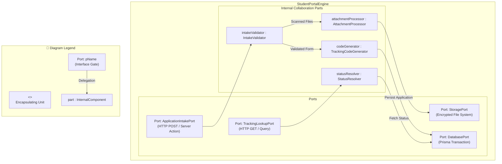

# Composite Structure Diagram: Student Applicant Domain

## 1. Description
This composite structure diagram documents the internal collaboration parts, communication ports, and connectors inside the `StudentPortalEngine` that powers the scholarship intake and tracking interface.

## 2. ASD-STE100 Technical Specifications
- Define public-facing input ports for application submission and tracking lookups.
- Connect internal file parsers to storage connectors through isolated ports.
- Route completed application objects through an atomic database connector.

## 3. Composite Structure Diagram (Mermaid)

---

## 4. Diagram Legend & Symbol Guide

| Visual Symbol | Syntax / Style | UML Structural Role | MinSU System Implementation |
|---|---|---|---|
| Outer Classifier | `subgraph UNIT` (`#F6F8F6`) | Encapsulating software unit | Domain engine or controller containing internal operational logic |
| 🟨 Port Node | `pName` (`#FFF1C2` / `#F2B705`) | Interaction boundary / gate | Inbound HTTP ports, state change events, database ports |
| ⬜ Internal Part | `part : Class` (`#FFFFFF` / `#1B5E20`) | Component instance owned by classifier | Schema validators, state machines, PDF compilers, audit loggers |
| `-->` Connector | Solid Arrow | Internal connector or port delegation | Linking external ports to internal validators and persistent adapters |

## 5. Internal Part Functions
- **IntakeValidator**: Checks student enrollment records, eligibility criteria, and required field inputs.
- **AttachmentProcessor**: Enforces file format limits, inspects virus signatures, and writes files to storage.
- **TrackingCodeGenerator**: Creates human-readable tracking identifiers (e.g., `TDP-2026-0842`).
- **StatusResolver**: Queries the database to retrieve current application milestones for student tracking.
