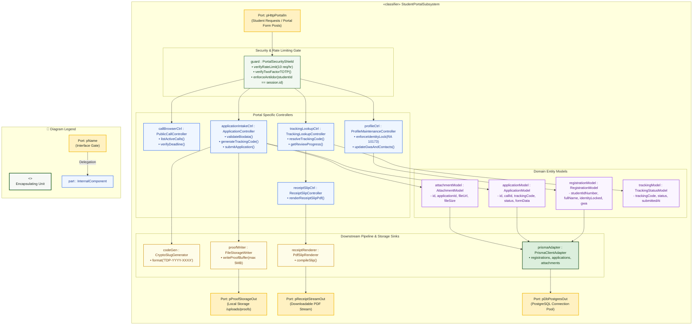

# Composite Structure Diagram: Student Applicant Domain

> **Role:** `STUDENT` (Public Scholarship Portal & Applicant)  
> **Diagram Type:** Composite Structure Diagram  
> **Classifier:** `StudentPortalSubsystem`

---

## 1. Purpose

This Composite Structure Diagram depicts the internal architecture of the `StudentPortalSubsystem`. It shows how student requests route through rate limiting and 2FA guards to specialized controllers for scholarship applications, tracking lookups, and RA 10173 profile maintenance, connecting downstream to database adapters and proof storage.

---

## 2. Mermaid Composite Structure Diagram

---

## 3. Diagram Legend & Symbol Guide

| Symbol | UML Concept | Technical Function | MinSU Operational Meaning |
|---|---|---|---|
| `«classifier»` | Subsystem Classifier | Encapsulates internal structural parts | `StudentPortalSubsystem` |
| `Port` | Port Boundary | Ingress/egress interaction gate | HTTP Ingress, Proofs Storage Out, PostgreSQL Out |
| `part` | Internal Component Part | Role controller or internal service | `ApplicationController`, `ProfileMaintenanceController` |
| `-->` | Connector | Structural delegation or data flow | Delegates verified application data to storage adapters |
