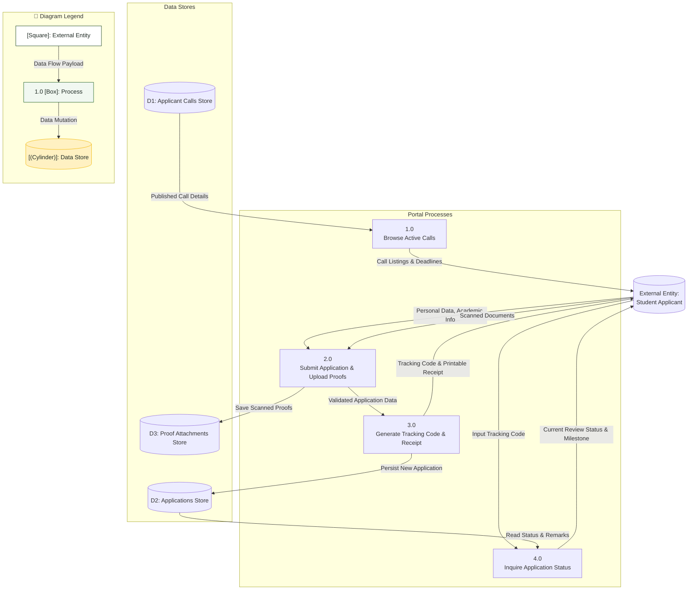

# Data Flow Diagram (DFD): Student Applicant Domain

## 1. Description
This Level 1 Data Flow Diagram traces information flow through the student portal subsystem. It maps how student applicants submit application data, upload documentary proofs, generate tracking codes, retrieve application statuses, and download official receipt slips.

## 2. ASD-STE100 Technical Specifications
- Trace all input data flows from the external student entity.
- Store submission records in secure application and file data stores.
- Provide tracking code resolution with read-only access.
- Restrict student modification once an application enters the submitted state.

## 3. Data Flow Diagram (Mermaid)

---

## 4. Diagram Legend & Symbol Guide

| DFD Element Shape | Gane & Sarson / Yourdon Notation | Technical Role | MinSU System Implementation |
|---|---|---|---|
| `[Rectangle]` | External Entity | Source or sink outside the process boundary | Students, Staff Coordinator, Campus Director, Accounting, CHED Agency |
| `(("((Double Circle))"))` | Context Process (Level 0) | Top-level system boundary | Entire MinSU DocTrack system |
| `["1.0 Process"]` | Operational Process (Level 1) | Data transformation or business logic step | Intake Applications, Validate Annexes, Executive Review, Financials |
| `[("[(Cylinder)]")]` | Persistent Data Store | Relational table or permanent data repository | Users & Sessions, Applications, Documents, Transmittals, Audit Logs |
| `-->|Data Flow|` | Named Flow Arrow | In-transit data packet or payload | Forms, tracking codes, financial records, audit rows |
| 🟢 Green Box | Process Node | Active workflow processing unit | Core backend services and transaction coordinators |
| 🟨 Gold Cylinder | Data Store Node | Persistent PostgreSQL / File store | Secure database tables with RLS and foreign key integrity |

## 5. Flow Details
- **Process 1.0 (Browse Active Calls)**: Delivers active scholarship announcements, quotas, and deadline timetables to prospective applicants.
- **Process 2.0 (Submit Application & Upload Proofs)**: Ingests student profiles and scans, validating format compliance before dispatching.
- **Process 3.0 (Generate Tracking Code & Receipt)**: Issues a verified unique token (`TDP-YYYY-XXXX`) and produces a confirmation slip.
- **Process 4.0 (Inquire Application Status)**: Queries the database using the unique token and displays current qualification status without requiring a login account.
