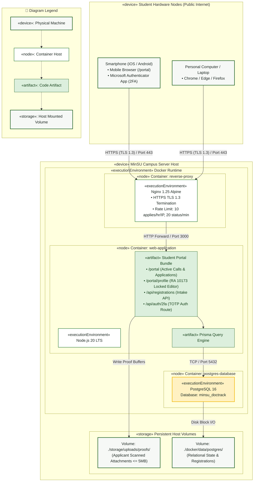

# Student Applicant — Deployment Diagram

> **Role:** `STUDENT`  
> **Diagram Type:** Deployment Diagram  
> **Standard:** UML 2.5 Deployment Specification

---

## 1. Purpose

The Deployment Diagram shows the hardware devices, mobile clients, Docker container boundaries, and network topologies supporting the Student Portal, Microsoft Authenticator 2FA, and application intake.

---

## 2. Mermaid Deployment Diagram

---

## 3. Diagram Legend & Symbol Guide

| Visual Symbol | Syntax / Style | UML Deployment Concept | MinSU Implementation |
|---|---|---|---|
| `«device»` | Double Angle Bracket | Hardware computational machine | Student Mobile / PC, MinSU Server Host |
| `«node»` | Container Box | Virtualized runtime environment | Reverse proxy, Node.js web application, PostgreSQL |
| `«artifact»` | Shaded Component | Executable software code or bundle | Student Portal SPA, Registration API, Prisma engine |
| `«storage»` | Volume Node | File system partition on host | Mounted proofs storage volume, PostgreSQL data blocks |

---

## 4. Deployment Specifications

- **Student Devices**: Interacts via responsive mobile browsers and generates 6-digit TOTP codes with Microsoft Authenticator.
- **Reverse Proxy**: Enforces anti-brute-force rate limiting (maximum 10 public submissions per IP per hour) and shields against DDoS attacks.
- **Application Container**: Sanitizes multipart proof uploads, validates 5 MB size thresholds, and issues cryptographic tracking codes.
- **Persistent Volumes**: Stores student attachments on dedicated disk mounts and commits registration rows to PostgreSQL.
