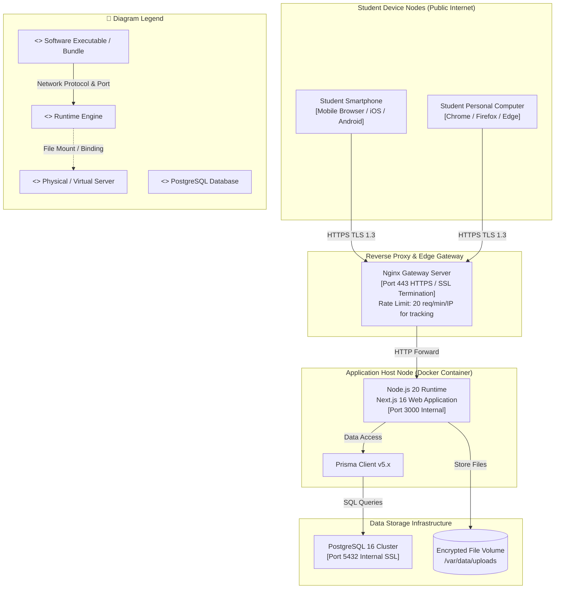

# Deployment Diagram: Student Applicant Domain

## 1. Description
This deployment diagram models the runtime execution environment and hardware topology for student interactions. It documents the network routes connecting external student smartphones, laptops, content delivery networks, application containers, and databases.

## 2. ASD-STE100 Technical Specifications
- Allow open public access to portal routes through standard HTTPS Port 443.
- Enforce strict DDoS mitigations and IP rate limiting at the reverse proxy.
- Deploy the Next.js portal application inside a scalable containerized node.
- Isolate student uploaded files in an authenticated static storage volume.

## 3. Deployment Diagram (Mermaid)

---

## 4. Diagram Legend & Symbol Guide

| Visual Symbol | Syntax / Style | UML Deployment Role | MinSU Infrastructure Context |
|---|---|---|---|
| `<<device>>` Box | `fill:#F6F8F6, stroke:#1B5E20` | Physical hardware or operating system host | Client Workstation, Ubuntu Linux Server |
| `<<node>>` Container | `fill:#F1F8F1, stroke:#164D1C` | Isolated containerized execution node | Docker containers: reverse-proxy, web-application, postgres-database |
| `<<executionEnvironment>>` | `fill:#FFFFFF, stroke:#2E7D32` | Application runtime or software engine | Node.js 20 LTS, Nginx 1.25 Alpine, Headless Chromium |
| `<<artifact>>` | `fill:#DCEFDD, stroke:#1B5E20` | Packaged deployable binary or file | Next.js standalone build, Prisma engine, nginx.conf |
| 🟨 Database Engine | `fill:#FFF1C2, stroke:#F2B705` | Relational database runtime | PostgreSQL 16 Alpine Server |
| `-->` Solid Arrow | Network Communication Link | Transport protocol and network port | Port 443 (HTTPS), Port 3000 (Internal HTTP), Port 5432 (Internal TCP) |
| `-.->` Dashed Arrow | Storage Mount / Stream | Host volume bind mount or disk I/O | `./uploads` (Signed PDF scans) and `pgdata` (PostgreSQL WAL files) |

## 5. Node Responsibilities
- **Student Device Nodes**: External clients accessing public portal routes without university intranet constraints.
- **Reverse Proxy & Edge Gateway**: Filters malicious requests, terminates SSL certificates, and applies rate limits.
- **Application Host Node**: Serves React Server Components, executes form parsing, and computes tracking tokens.
- **Storage Infrastructure**: Stores structured relational data and encrypted PDF attachments.
