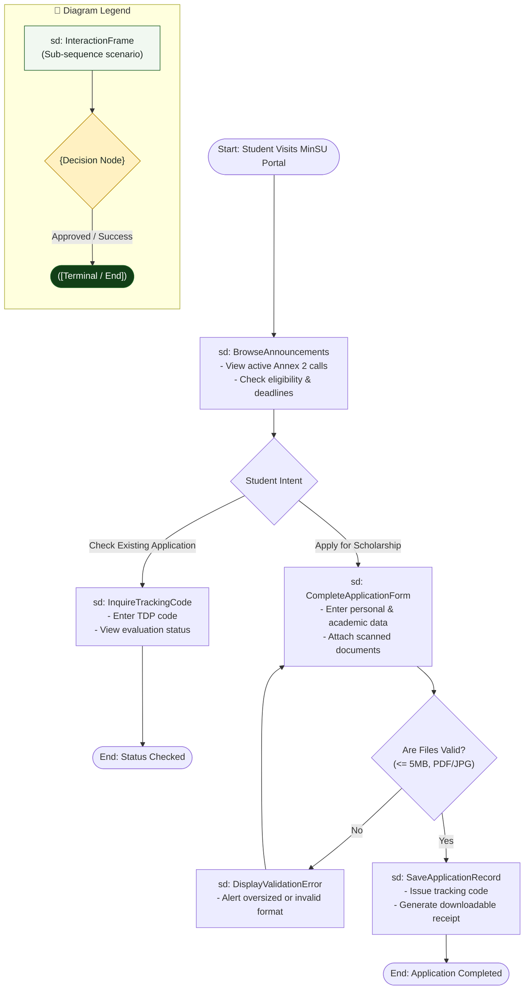

# Interaction Overview Diagram: Student Applicant Domain

## 1. Description
This interaction overview diagram combines high-level activity decision logic with sequence interaction frames to depict the student journey from discovering scholarship opportunities to tracking qualification results.

## 2. ASD-STE100 Technical Specifications
- Illustrate student navigation choices using decision nodes.
- Reference sequence interactions inside enclosed frame boxes.
- Guide failed submissions through corrective loops before completion.

## 3. Interaction Overview Diagram (Mermaid)

---

## 4. Diagram Legend & Symbol Guide

| Symbol / Element | Syntax / Type | Technical Meaning | MinSU Interaction Context |
|---|---|---|---|
| `sd: FrameName` | `["sd: ..."]` | Sequence interaction scenario frame | Encapsulates an entire sequence scenario (e.g., `Authenticate`, `ReviewQueue`) |
| `{Decision}` | `{"Decision"}` | Activity decision branch point | Critical decision gate (e.g., approval vs. return, variance check) |
| `([Pill Node])` | `([Start / End])` | Lifecycle start or terminal archive node | Initiating semester operations or locking final records in archive |
| `-->` Solid Arrow | Control Flow Connector | Sequential hand-off between frames | Passing control from one interaction frame to the next |
| `-->|Label|` | Guarded Branch | Conditional scenario path | "Yes: Approved", "No: Discrepancy", "Return with Remarks" |
| 🟢 Green Box | `#F1F8F1` / `#1B5E20` | Successful Workflow Phase | Forward operational processing and executive approval |
| 🟡 Gold Diamond | `#FFF1C2` / `#B88A00` | Institutional Checkpoint | Evaluation queue and zero-variance fiscal math check |

## 5. Interaction Frame Descriptions
- **BrowseAnnouncements**: Presents open TDP calls, available campus quotas, and strict submission cutoff dates.
- **InquireTrackingCode**: Provides instant evaluation feedback for existing applicants.
- **CompleteApplicationForm**: Collects student biodata, academic program details, and proof documents.
- **DisplayValidationError**: Warns students of invalid attachments or empty required fields.
- **SaveApplicationRecord**: Commits the verified application packet and outputs a printable receipt slip.
