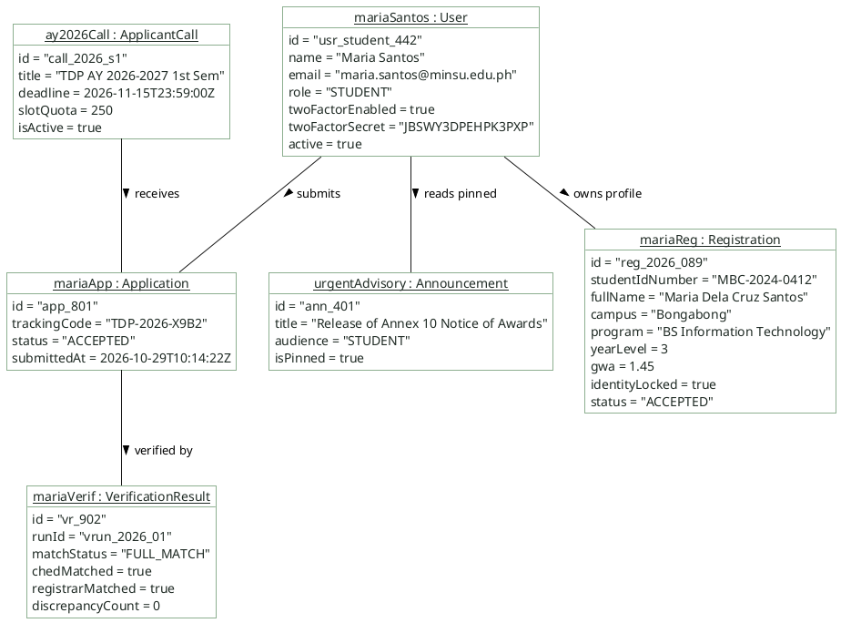

# Student Applicant — Object Diagram

> **Role:** `STUDENT`  
> **Diagram Type:** Object Diagram  
> **Scenario:** Runtime Snapshot of Authenticated Student, 2FA Setup, Submitted Application & Immutable Profile  
> **Standard:** UML 2.5 Object Specification

---

## 1. Purpose

The Object Diagram shows a concrete runtime snapshot of a student applicant within the MinSU DocTrack system. It displays actual attribute values and instance links in memory and database storage during the Tulong Dunong Program (TDP) intake cycle.

---

## 2. Mermaid Object Diagram

```mermaid
flowchart TD
    %% Styling Classes
    classDef objStyle fill:#FFFFFF,stroke:#1B5E20,stroke-width:2px,color:#1F2A24;
    classDef linkStyle stroke:#1B5E20,stroke-width:1.5px;
    classDef lockedStyle fill:#F1F8F1,stroke:#1B5E20,stroke-width:2px,color:#123F17;

    studentUser["<u>mariaSantos : User</u><br/>id = 'usr_student_442'<br/>name = 'Maria Santos'<br/>email = 'maria.santos@minsu.edu.ph'<br/>role = 'STUDENT'<br/>twoFactorEnabled = true<br/>twoFactorSecret = 'JBSWY3DPEHPK3PXP'<br/>active = true"]:::objStyle

    studentReg["<u>mariaReg : Registration</u><br/>id = 'reg_2026_089'<br/>studentIdNumber = 'MBC-2024-0412'<br/>fullName = 'Maria Dela Cruz Santos'<br/>campus = 'Bongabong'<br/>program = 'BS Information Technology'<br/>yearLevel = 3<br/>gwa = 1.45<br/>identityLocked = true<br/>status = 'ACCEPTED'"]:::lockedStyle

    activeCall["<u>ay2026Call : ApplicantCall</u><br/>id = 'call_2026_s1'<br/>title = 'TDP AY 2026-2027 1st Sem'<br/>deadline = 2026-11-15T23:59:00Z<br/>slotQuota = 250<br/>isActive = true"]:::objStyle

    submittedApp["<u>mariaApp : Application</u><br/>id = 'app_801'<br/>trackingCode = 'TDP-2026-X9B2'<br/>status = 'ACCEPTED'<br/>submittedAt = 2026-10-29T10:14:22Z"]:::objStyle

    appProof["<u>gradeProof : DocumentProof</u><br/>id = 'proof_1042'<br/>fileName = 'grades_santos_3rd_yr.pdf'<br/>mimeType = 'application/pdf'<br/>fileSize = 1845200<br/>verified = true"]:::objStyle

    verifResult["<u>mariaVerif : VerificationResult</u><br/>id = 'vr_902'<br/>runId = 'vrun_2026_01'<br/>matchStatus = 'FULL_MATCH'<br/>chedMatched = true<br/>registrarMatched = true<br/>discrepancyCount = 0"]:::objStyle

    studentAnnouncement["<u>urgentAdvisory : Announcement</u><br/>id = 'ann_401'<br/>title = 'Release of Annex 10 Notice of Awards'<br/>audience = 'STUDENT'<br/>isPinned = true"]:::objStyle

    studentUser ---|authenticates with 2FA| studentReg
    studentUser ---|submits| submittedApp
    activeCall ---|contains| submittedApp
    submittedApp ---|attaches| appProof
    submittedApp ---|evaluated by| verifResult
    studentUser ---|reads pinned| studentAnnouncement

    %% ─── 📌 VISUAL LEGEND ───
    subgraph Legend ["📌 Diagram Legend"]
        direction TB
        L_Inst["instanceName : ClassName<br/>attribute1 = value<br/>attribute2 = value"]:::legInst
        L_Locked["instanceName : ClassName<br/>identityLocked = true"]:::legLocked
        L_Link["Link: --- predicate ---"]:::legLink
        L_Inst --> L_Locked
        L_Locked --> L_Link
    end
    classDef legInst fill:#FFFFFF,stroke:#1B5E20,color:#1F2A24;
    classDef legLocked fill:#F1F8F1,stroke:#1B5E20,stroke-width:2px,color:#123F17;
    classDef legLink fill:#FFF1C2,stroke:#B88A00,color:#1F2A24;
```

---

## 3. Diagram Legend & Symbol Guide

| Visual Symbol | Syntax / Format | UML Role | MinSU Instance Context |
|---|---|---|---|
| Instance Node | `instanceName : ClassName` | Concrete runtime instance in memory/DB | Student user, active scholarship call, submitted application |
| Attribute Values | `attr = 'value'` | Concrete state of instance properties | `status = 'ACCEPTED'`, `twoFactorEnabled = true`, `identityLocked = true` |
| Locked Node | `identityLocked = true` | Immutable RA 10173 student identity record | Student ID Number and Full Legal Name locked from tampering |
| `---|predicate|` | Association Link | Concrete relationship between runtime objects | User submits application, system evaluates verification result |
| 🟢 Green Container | `#F1F8F1` / `#1B5E20` | Operational Domain Entities | Authenticated student profiles, accepted scholarship records |
| 🟡 Gold Node | `#FFF1C2` / `#B88A00` | Security & Token Metadata | TOTP secrets, tracking codes, and pinned announcements |

---

## 4. PlantUML Object Diagram



---

## 5. Technical Specifications & Integrity Rules

- **2FA Credentials**: The `User` record holds `twoFactorEnabled = true` with a base32 TOTP secret for Microsoft Authenticator verification.
- **Data Privacy & Identity Lock**: Under RA 10173, the `Registration` record locks `studentIdNumber` and `fullName` once marked `ACCEPTED`.
- **Tripartite Verification Link**: The `VerificationResult` instance links the application to the automated CHED and Registrar cross-matching engine.
- **Announcement Audience**: Students receive targeted campus announcements filtered by `audience = 'STUDENT'` or `audience = 'ALL'`.
