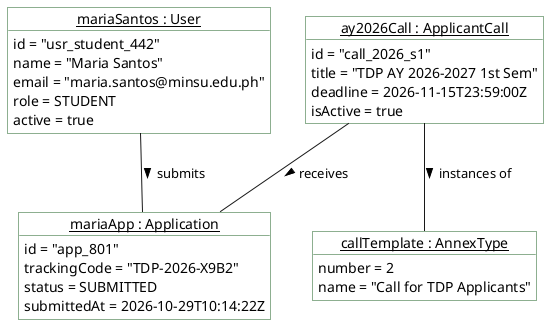

# Student Applicant — Object Diagram

> **Role:** `STUDENT`  
> **Diagram Type:** Object Diagram  
> **Scenario:** Runtime Snapshot of a Submitted Student Application  
> **Standard:** UML 2.5 Object Specification

---

## 1. Purpose

The Object Diagram shows a concrete runtime snapshot of an application instance submitted by a student. It shows real attribute values and links between instances at a specific point in time.

---

## 2. Mermaid Object Diagram

```mermaid
flowchart TD
    %% Styling Classes
    classDef objStyle fill:#FFFFFF,stroke:#1B5E20,stroke-width:2px,color:#1F2A24;
    classDef linkStyle stroke:#1B5E20,stroke-width:1.5px;

    studentUser["<u>mariaSantos : User</u><br/>id = 'usr_student_442'<br/>name = 'Maria Santos'<br/>email = 'maria.santos@minsu.edu.ph'<br/>role = STUDENT<br/>active = true"]:::objStyle

    activeCall["<u>ay2026Call : ApplicantCall</u><br/>id = 'call_2026_s1'<br/>title = 'TDP AY 2026-2027 1st Sem'<br/>deadline = 2026-11-15T23:59:00Z<br/>isActive = true"]:::objStyle

    submittedApp["<u>mariaApp : Application</u><br/>id = 'app_801'<br/>trackingCode = 'TDP-2026-X9B2'<br/>status = SUBMITTED<br/>submittedAt = 2026-10-29T10:14:22Z"]:::objStyle

    annexType2["<u>callTemplate : AnnexType</u><br/>number = 2<br/>name = 'Call for TDP Applicants'"]:::objStyle

    studentUser ---|submits| submittedApp
    activeCall ---|contains| submittedApp
    activeCall ---|conforms to| annexType2

    %% ─── 📌 VISUAL LEGEND ───
    subgraph Legend ["📌 Diagram Legend"]
        direction TB
        L_Inst["instanceName : ClassName<br/>attribute1 = value<br/>attribute2 = value"]:::legInst
        L_Link["Link: --predicate-->"]:::legLink
        L_Inst --> L_Link
    end
    classDef legInst fill:#F1F8F1,stroke:#1B5E20,color:#1F2A24;
    classDef legLink fill:#FFF1C2,stroke:#B88A00,color:#1F2A24;
```

---

## 3. Diagram Legend & Symbol Guide

| Visual Symbol | Syntax / Format | UML Role | MinSU Instance Context |
|---|---|---|---|
| Instance Node | `instanceName : ClassName` | Concrete runtime instance in memory/DB | Active users, specific scholarship calls, concrete annex documents |
| Attribute Values | `attr = 'value'` | Concrete state of instance properties | `status = 'APPROVED'`, `trackingCode = 'TDP-2026-0192'`, `slotQuota = 250` |
| `-->|predicate|` | Directed Association Link | Concrete relationship between runtime objects | User compiles document, director endorses record, transmittal dispatches |
| Subgraph Boundary | `subgraph GroupName` | Domain grouping boundary | Active Users, Intake Instances, Compiled Annexes, Transmittal Audits |
| 🟢 Green Container | `#F1F8F1` / `#1B5E20` | Operational Domain Entities | Authenticated staff/director records and approved scholarship documents |
| 🟡 Gold Node | `#FFF1C2` / `#B88A00` | Financial & Security Linkages | Ledger documents and audit log event tracking |


---

## 4. PlantUML Object Diagram



---

## 5. Instance Details

- **Snapshot Context**: Student Maria Santos has just completed her online submission.
- **Values**: Attribute values represent real database strings and timestamps rather than abstract types.
- **Link Integrity**: The links map directly to foreign key associations (`studentId` and `callId`) defined in the Prisma schema.
