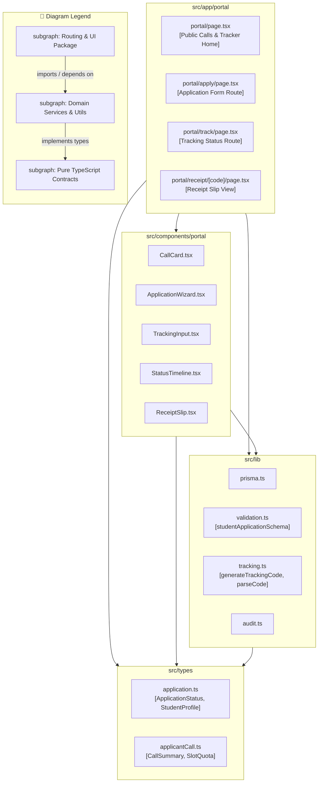

# Package Diagram: Student Applicant Domain

## 1. Description
This package diagram depicts the directory structure, modular packages, and namespace dependencies supporting the student portal subsystem within MinSU DocTrack.

## 2. ASD-STE100 Technical Specifications
- Structure student features under the public `src/app/portal` route package.
- Group student UI components into a dedicated `src/components/portal` package.
- Share data validation schemas and tracking generators through the common `src/lib` package.

## 3. Package Diagram (Mermaid)

---

## 4. Diagram Legend & Symbol Guide

| Visual Symbol | Syntax / Style | UML Package Concept | MinSU DocTrack Codebase Structure |
|---|---|---|---|
| 🟩 Green Folder | `fill:#F1F8F1, stroke:#1B5E20` | Presentation & Routing Package | Next.js App Router (`src/app`) & React components (`src/components`) |
| 🟨 Gold Folder | `fill:#FFF1C2, stroke:#F2B705` | Core Business & Lib Services | Prisma singleton, crypto auth, RBAC guards, PDF compiler (`src/lib`) |
| 🟩 Dark Green Box | `fill:#DCEFDD, stroke:#123F17` | Contract & Persistence Schema | Strictly typed schemas (`src/types`) and ORM definition (`prisma/`) |
| `-->` Solid Arrow | Downward Package Dependency | Upstream module imports or depends on downstream services (strictly unidirectional) |

## 5. Package Contents
- **`src/app/portal`**: App Router pages serving student onboarding, application wizards, and status inquiries.
- **`src/components/portal`**: Specialized React components including multi-step wizards, timeline badges, and receipt cards.
- **`src/lib`**: Shared services containing database singleton, tracking algorithms, and Zod input validators.
- **`src/types`**: Type declarations defining applicant statuses, call quotas, and submission interfaces.
