# Student Applicant — Package Diagram

> **Role:** `STUDENT`  
> **Diagram Type:** Package Diagram  
> **Scope:** Student Portal, 2FA Verification, Application Wizards & Profile Subsystems  
> **Standard:** UML 2.5 Package Specification

---

## 1. Purpose

The Package Diagram shows the directory structure, modular packages, and namespace dependencies supporting the student portal subsystem within MinSU DocTrack.

---

## 2. Mermaid Package Diagram

```mermaid
graph TB
    subgraph PortalAppPackage ["src/app/portal (Student Routes)"]
        PortalHome["portal/page.tsx<br/>[Announcements & Call Catalog]"]
        ApplyRoute["portal/apply/page.tsx<br/>[Multi-Step Application Wizard]"]
        TrackRoute["portal/track/page.tsx<br/>[Tracking Code Status Lookup]"]
        ProfileRoute["portal/profile/page.tsx<br/>[RA 10173 Locked Profile View]"]
        ReceiptRoute["portal/receipt/[code]/page.tsx<br/>[Printable Receipt Slip]"]
    end

    subgraph PortalComponentsPackage ["src/components/portal (Presentation UI)"]
        CallCard["CallCard.tsx<br/>[Active Call Information Card]"]
        ApplicationWizard["ApplicationWizard.tsx<br/>[Dynamic Application Form]"]
        TrackingInput["TrackingInput.tsx<br/>[Anti-Scrape Status Search]"]
        StatusTimeline["StatusTimeline.tsx<br/>[Real-Time Progress Timeline]"]
        ReceiptSlip["ReceiptSlip.tsx<br/>[Official Application Receipt]"]
        StudentProfileCard["StudentProfileCard.tsx<br/>[Selective Identity Lock Display]"]
    end

    subgraph LibPackage ["src/lib (Domain & Security Services)"]
        PrismaSingleton["prisma.ts<br/>[Database Access Client]"]
        TwoFactorService["two-factor.ts<br/>[TOTP & Authenticator Verification]"]
        ValidationSchema["validation.ts<br/>[Zod Application & File Validator]"]
        TrackingHelper["tracking.ts<br/>[Unique Tracking Code Generator]"]
        AuditService["audit.ts<br/>[Tamper-Proof Audit Logger]"]
        RateLimitService["rate-limit.ts<br/>[Anti-Brute-Force IP Guard]"]
    end

    subgraph TypesPackage ["src/types (Strict TypeScript Contracts)"]
        AppTypes["application.ts<br/>[ApplicationStatus, StudentProfile]"]
        CallTypes["applicantCall.ts<br/>[ApplicantCall, SlotQuota]"]
        AnnouncementTypes["announcement.ts<br/>[Announcement, AudienceTier]"]
    end

    PortalAppPackage --> PortalComponentsPackage
    PortalAppPackage --> LibPackage
    PortalAppPackage --> TypesPackage
    PortalComponentsPackage --> LibPackage
    PortalComponentsPackage --> TypesPackage
    LibPackage --> TypesPackage

    %% ─── 📌 VISUAL LEGEND ───
    subgraph LEGEND ["📌 Diagram Legend"]
        direction TB
        L_App["subgraph: Routing & UI Package"]:::pkgStyle
        L_Lib["subgraph: Domain Services & Utils"]:::libStyle
        L_Type["subgraph: Pure TypeScript Contracts"]:::typeStyle
        L_App -->|imports / depends on| L_Lib
        L_Lib -->|implements types| L_Type
    end
    classDef pkgStyle fill:#F1F8F1,stroke:#1B5E20,stroke-width:1.5px,color:#1F2A24;
    classDef libStyle fill:#FFF1C2,stroke:#F2B705,stroke-width:1.5px,color:#1F2A24;
    classDef typeStyle fill:#DCEFDD,stroke:#123F17,stroke-width:1.5px,color:#123F17;
```

---

## 3. Diagram Legend & Symbol Guide

| Visual Symbol | Syntax / Style | UML Package Concept | MinSU DocTrack Codebase Structure |
|---|---|---|---|
| 🟩 Green Folder | `fill:#F1F8F1, stroke:#1B5E20` | Presentation & Routing Package | Next.js App Router (`src/app/portal`) & React components (`src/components/portal`) |
| 🟨 Gold Folder | `fill:#FFF1C2, stroke:#F2B705` | Core Business & Security Services | Prisma singleton, 2FA TOTP engine, tracking generator, and rate limiter (`src/lib`) |
| 🟩 Dark Green Box | `fill:#DCEFDD, stroke:#123F17` | Contract & Type Definitions | Strict TypeScript interfaces for applications, calls, and announcements (`src/types`) |
| `-->` Solid Arrow | Downward Package Dependency | Upstream module imports or depends on downstream services (strictly unidirectional) |

---

## 4. Package Contents & Responsibilities

- **`src/app/portal`**: App Router pages serving student onboarding, scholarship application wizards, status lookups, and RA 10173 profile views.
- **`src/components/portal`**: Specialized React components including multi-step wizards, timeline badges, receipt cards, and locked profile cards.
- **`src/lib`**: Shared services containing database singleton, Microsoft Authenticator TOTP verification, tracking code generators, and Zod input validators.
- **`src/types`**: Type declarations defining applicant statuses, call quotas, announcement tiers, and submission interfaces.
