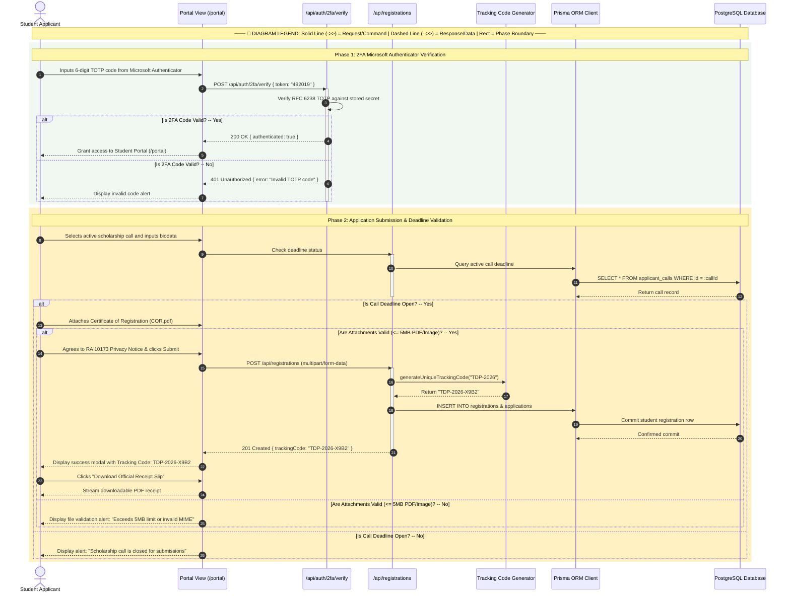

# Student Applicant — Sequence Diagram

> **Role:** `STUDENT`  
> **Diagram Type:** Sequence Diagram  
> **Scenario:** 2FA Setup, Online Application, Tracking Code Generation & Receipt Retrieval  
> **Standard:** UML 2.5 Sequence Specification

---

## 1. Purpose

The Sequence Diagram shows the chronological exchange of messages when a Student Applicant signs up with Microsoft Authenticator 2FA, submits an online application, receives an official tracking code, and downloads a receipt slip. All decision alternatives evaluate strictly to binary Yes and No paths.

---

## 2. Mermaid Sequence Diagram

---

## 3. Diagram Legend & Symbol Guide

| Visual / Symbol | Element Type | Technical Role | MinSU DocTrack Context |
|---|---|---|---|
| `Actor` | Human User | Initiator of operational procedures | Student Applicant submitting credentials |
| `Participant` | System Component | Boundary, controller, or data store | Portal UI, 2FA Controller, Prisma ORM, PostgreSQL |
| `->>` | Synchronous Message | Command or method invocation | Verify TOTP, check deadline, commit registration |
| `-->>` | Return Message | Response data or confirmation payload | Returns 200 OK, tracking code, downloadable receipt |
| `alt / else` | Conditional Frame | Guarded execution path (**Yes** / **No**) | Is Code Valid? Yes -> proceed; No -> alert |

---

## 4. Execution Sequence Steps

1. Student enters the 6-digit TOTP code from Microsoft Authenticator.
2. If the 2FA code is valid (**Yes**), system grants session access to `/portal`.
3. If invalid (**No**), system halts with an authentication error.
4. Student selects an active scholarship call.
5. If deadline is open (**Yes**), system validates document size and MIME types.
6. If attachments are valid (**Yes**), system saves the application, issues a tracking code, and generates a printable receipt.
7. If attachments are invalid (**No**), system prompts for compliant files.
8. If the deadline has elapsed (**No**), system displays a call closed banner.
