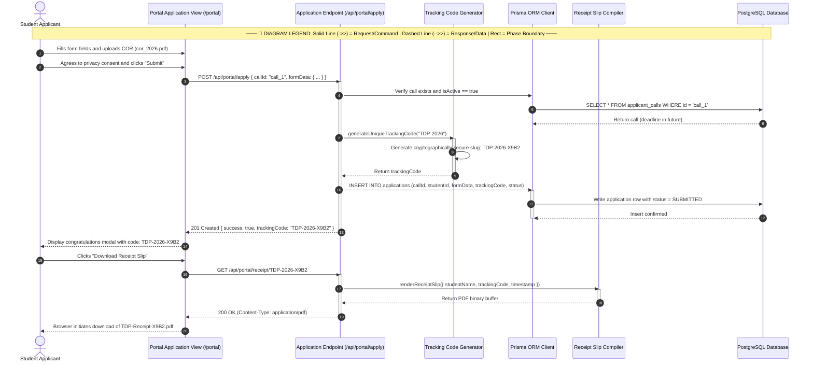

# Student Applicant — Sequence Diagram

> **Role:** `STUDENT`  
> **Diagram Type:** Sequence Diagram  
> **Scenario:** Application Submission, Tracking Code Generation & Receipt Retrieval

---

## 1. Purpose

The Sequence Diagram shows the chronological exchange of messages when a Student Applicant submits an online scholarship application and receives an official tracking code and receipt.

---

## 2. Mermaid Sequence Diagram

---

## 3. Diagram Legend & Symbol Guide

| Visual / Symbol | Element Type | Technical Role | MinSU DocTrack Context |
|---|---|---|---|
| 👤 `actor` | Human Actor | External user role triggering system operations | Student Applicant, Staff Coordinator, Campus Director, Accounting Officer |
| 🔲 `participant` | System Component | Internal software subsystem or persistence boundary | Web UI, API Endpoint, Workflow Engine, Prisma/PostgreSQL, PDF Compiler |
| ──▶ `->>` | Solid Arrow | Synchronous invocation or command message | Submitting forms, verifying tokens, invoking database writes |
| - - ▷ `-->>` | Dashed Arrow | Return response or data payload | Confirmation slips, tracking codes, PDF binary buffers, query results |
| 🔲 `activate / deactivate` | Activation Lifeline | Period during which a component executes logic | Active request execution on API controllers or PDF engines |
| 🔲 `alt / else` | Conditional Fragment | Decision tree handling alternative workflow paths | Approval vs. Return branching, SLA compliance checks |

---

## 4. Sequence Details

1. Student completes personal information and attaches documentary files.
2. API confirms that the target scholarship call is currently active.
3. Code Generator constructs a unique uppercase alphanumeric tracking code.
4. Database records the application in `SUBMITTED` status.
5. Student receives visual confirmation and clicks to download the official receipt.
6. PDF Engine compiles the verification slip containing the university seal and timestamp.
