# Student Applicant — State Machine Diagram

> **Role:** `STUDENT`  
> **Diagram Type:** State Machine Diagram  
> **Entity:** `Application` & `Registration`  
> **Standard:** UML 2.5 State Machine Specification

---

## 1. Purpose

The State Machine Diagram shows the complete lifecycle of a student's scholarship application and registration profile. It details the progression from initial online submission, staff evaluation, binary eligibility decisions, and permanent identity locking under RA 10173.

---

## 2. Mermaid State Machine Diagram

```mermaid
stateDiagram-v2
    [*] --> DRAFT : startApplication() [active call open]
    DRAFT --> SUBMITTED : submitOnline() [form valid & files uploaded]

    SUBMITTED --> UNDER_REVIEW : beginEvaluation() [staff opens student records]

    state check_eligibility <<choice>>
    UNDER_REVIEW --> check_eligibility : evaluateCriteria()

    check_eligibility --> ACCEPTED : [Meets TDP Criteria? -- Yes]
    check_eligibility --> REJECTED : [Meets TDP Criteria? -- No]

    ACCEPTED --> PROFILE_LOCKED : lockIdentity() [RA 10173 permanent lock]
    PROFILE_LOCKED --> [*]
    REJECTED --> [*]

    %% ─── 📌 VISUAL LEGEND ───
    note right of UNDER_REVIEW
        <b>📌 DIAGRAM LEGEND</b>
        ● [*] : Initial / Terminal Boundary
        [StateName] : Active Lifecycle Status
        <<choice>> : Binary Decision (Yes / No)
        --> : Trigger Event Transition
        [guard] : Mandatory Guard Condition
    end note
```

---

## 3. Diagram Legend & Symbol Guide

| Visual Symbol / Syntax | UML State Machine Concept | Technical Meaning | MinSU Document & Student Lifecycle |
|---|---|---|---|
| `● [*]` | Initial State Node | Point of entry into application lifecycle | Student initiates dynamic application form |
| `◎ [*]` | Terminal State Node | Final conclusion of application lifecycle | Record locked as active scholar or archived upon rejection |
| `state Name` | Core State | Active lifecycle state in database | `DRAFT`, `SUBMITTED`, `UNDER_REVIEW`, `ACCEPTED`, `PROFILE_LOCKED` |
| `<<choice>>` | Choice Pseudostate | Dynamic runtime branch evaluating conditions | Binary branch evaluating student qualifications (`Yes` / `No`) |
| `-->` | Transition Arrow | State change triggered by event or action | Student submits, coordinator evaluates, system locks identity |
| `[guardCondition]` | Transition Guard | Boolean condition that must evaluate to TRUE | `[form valid]`, `[Meets TDP Criteria? -- Yes]`, `[RA 10173 lock]` |

---

## 4. State Definitions & Transitions

| State | Portal Visual Badge | Allowed Actions & Trigger | Next State |
|---|---|---|---|
| `DRAFT` | "In Progress" (Gray) | Student edits demographics, uploads proofs, or saves draft. | `SUBMITTED` |
| `SUBMITTED` | "Application Received" (Blue) | System assigns tracking code (`TDP-YYYY-XXXX`). Staff queued. | `UNDER_REVIEW` |
| `UNDER_REVIEW` | "Under Evaluation" (Gold) | Coordinator verifies grades, COR, and runs 3-way verification. | `check_eligibility` |
| `check_eligibility` | N/A (Choice Diamond) | Coordinator determines if student satisfies academic and indigency standards. | `ACCEPTED` (Yes) / `REJECTED` (No) |
| `ACCEPTED` | "Official Grantee" (Green) | Included in Annex 1 masterlist and Annex 10 Notice of Awards. | `PROFILE_LOCKED` |
| `PROFILE_LOCKED` | "Verified Scholar" (Dark Green) | Student ID and Name permanently locked from editing; GWA editable. | Terminal `[*]` |
| `REJECTED` | "Application Unsuccessful" (Red) | Feedback comments provided; student notified via portal inquiry. | Terminal `[*]` |

---

## 5. Technical Specifications & Integrity Rules

- **Binary Decision Strictness**: The evaluation choice pseudostate branches strictly into `[Meets TDP Criteria? -- Yes]` and `[Meets TDP Criteria? -- No]`.
- **Identity Lock Automation**: Moving to `ACCEPTED` triggers `ProfileLockController`, setting `identityLocked = true` on the student registration record.
- **Audit Logging**: Every transition between states executes `logAudit()` with actor ID, timestamp, and previous/new state values.
