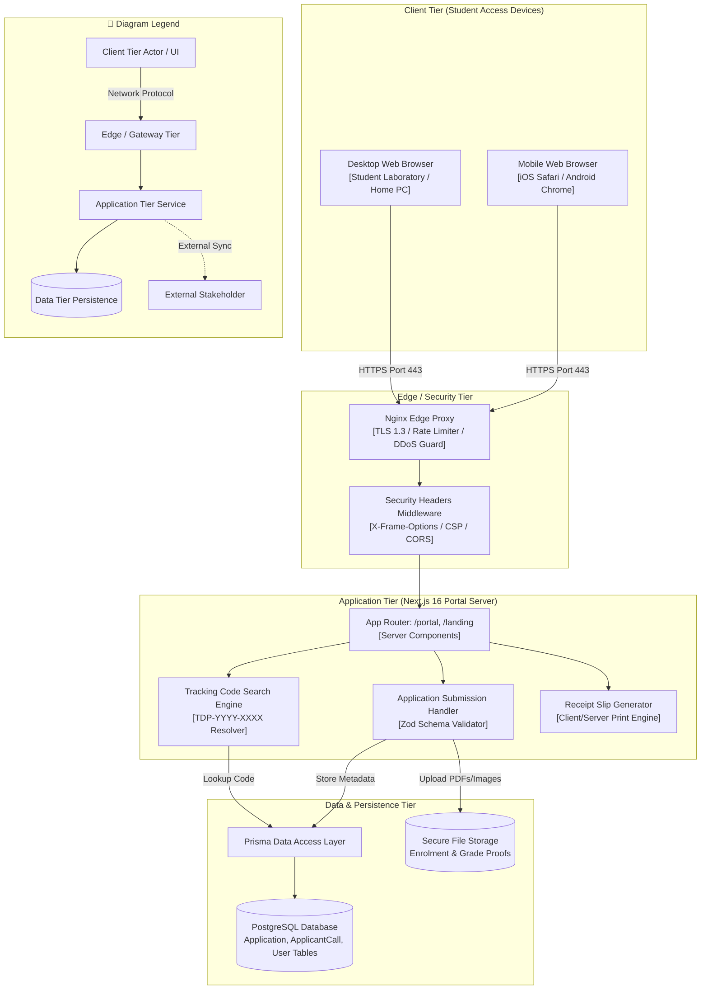

# System Architecture Diagram: Student Applicant Domain

## 1. Description
This system architecture diagram illustrates the end-to-end multi-tier architecture serving student scholarship applicants in MinSU DocTrack. It shows how students interact with the public landing page, browse active Annex 2 TDP calls, submit digital application packets, track progress with tracking codes (`TDP-YYYY-XXXX`), and download PDF confirmation slips.

## 2. ASD-STE100 Technical Specifications
- Expose public endpoints through server-side rendered routes in the Next.js App Router.
- Enforce file upload size limits (maximum 5MB per document) and MIME type validation.
- Store tracking code tokens in indexed database columns for fast retrieval.
- Safeguard student privacy through restricted public querying interfaces.

## 3. System Architecture Diagram (Mermaid)

---

## 4. Diagram Legend & Symbol Guide

| Visual Symbol | Syntax / Style | Architectural Tier | MinSU System Implementation |
|---|---|---|---|
| 🟩 Soft Green Box | `fill:#F1F8F1, stroke:#1B5E20` | Client Presentation Tier | Browser clients for Student, Staff, Director, Accounting, and Admin |
| 🟨 Gold Box | `fill:#FFF1C2, stroke:#F2B705` | Edge & Security Gateway Tier | Nginx TLS termination reverse-proxy and Next.js edge RBAC middleware |
| ⬜ White Box | `fill:#FFFFFF, stroke:#1B5E20` | Core Application Tier | Next.js Server Components, Document Engine, Auth Controller, PDF Compiler |
| 🟩 Dark Green Cylinder | `fill:#DCEFDD, stroke:#123F17` | Persistent Data Tier | PostgreSQL 16 relational database (Port 5432) and local storage volumes |
| ◻️ Dashed Border Box | `stroke-dasharray: 5 5` | External Stakeholder / Boundary | CHED/UniFAST regional office and external Google Drive transmittal archive |
| `-->` Solid Arrow | Network & Internal Call | Synchronous HTTPS, WSS, HTTP (port 3000), or TCP (port 5432) |
| `-.->` Dashed Arrow | Out-of-Band Integration | Physical courier shipment or external cloud drive URL synchronization |

## 5. Tier Responsibilities
- **Client Tier**: Responsive web portal optimized for mobile phones and campus laboratory PCs.
- **Edge Tier**: Provides SSL termination, cross-origin request protection, and request rate limiting.
- **Application Tier**: Validates student inputs, verifies open application deadlines, and renders receipt slips.
- **Data Tier**: Stores encrypted student applications, attachments, and application call parameters.
