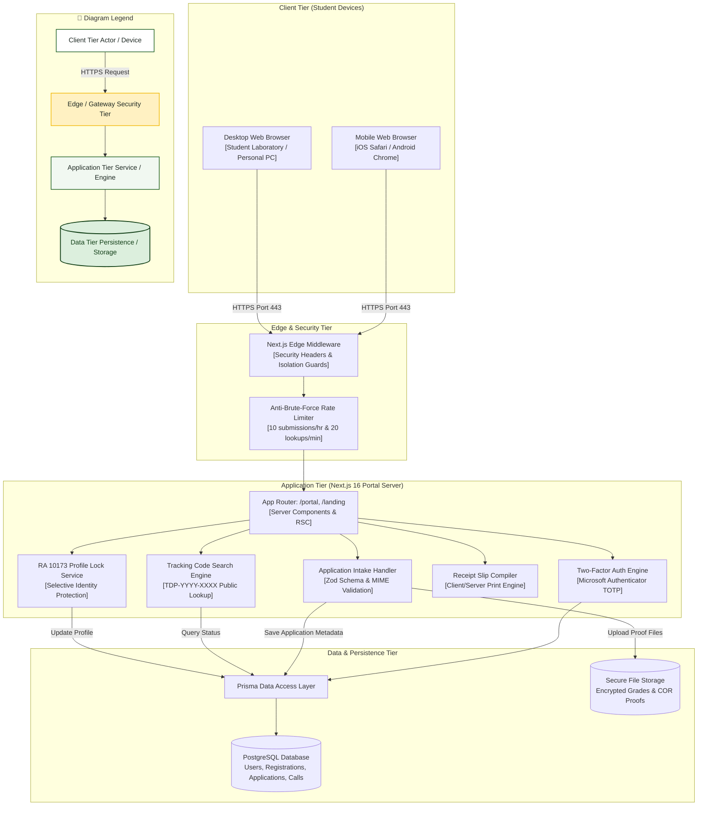

# Student Applicant — System Architecture Diagram

> **Role:** `STUDENT`  
> **Diagram Type:** System Architecture Diagram  
> **Scope:** Student Portal, 2FA Verification, Application Ingestion & Storage Architecture  
> **Standard:** ISO/IEC/IEEE 42010 Architecture Description

---

## 1. Purpose

The System Architecture Diagram shows the multi-tier hardware and software architecture serving student scholarship applicants in MinSU DocTrack. It details how students authenticate with Microsoft 2FA, browse active TDP calls, submit digital application packets, track progress, and access protected profile records.

---

## 2. Mermaid System Architecture Diagram

---

## 3. Diagram Legend & Symbol Guide

| Visual Symbol | Syntax / Style | Architecture Tier | MinSU Implementation Mapping |
|---|---|---|---|
| ⬜ Client Box | `fill:#FFFFFF, stroke:#1B5E20` | Client Presentation Tier | Responsive mobile and desktop browsers |
| 🟨 Gold Box | `fill:#FFF1C2, stroke:#F2B705` | Edge & Security Tier | Next.js Edge Middleware and IP-based rate limiters |
| 🟩 Light Green Box | `fill:#F1F8F1, stroke:#1B5E20` | Application Server Tier | React Server Components, 2FA controllers, and Zod validators |
| 🟩 Dark Green Cylinder | `fill:#DCEFDD, stroke:#123F17` | Data & Persistence Tier | PostgreSQL database and isolated file storage directories |
| `-->` Solid Arrow | Request / Data Flow | Directional communication between architectural tiers |

---

## 4. Architectural Layer Responsibilities

- **Client Tier**: Fully responsive mobile-first UI built with Tailwind CSS, supporting smartphones, tablets, and campus desktop laboratories.
- **Edge Tier**: Enforces strict HTTP security headers (`X-Frame-Options: SAMEORIGIN`, `nosniff`, `CSP`) and shields application endpoints against scraping and brute-force flooding.
- **Application Tier**: Next.js 16 App Router handles server-rendered student catalog pages, Microsoft Authenticator 2FA validation, Zod-guarded application intake, and PDF receipt rendering.
- **Data Tier**: Prisma ORM coordinates transactions across PostgreSQL tables while document proof assets reside securely in designated non-public storage directories.
