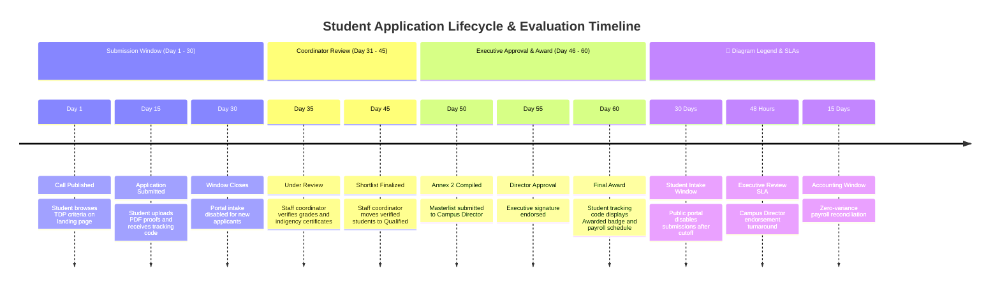

# Timing Diagram: Student Applicant Domain

## 1. Description
This timing diagram traces the time-based state transitions of a student scholarship application relative to administrative evaluation deadlines and submission cutoff schedules in MinSU DocTrack.

## 2. ASD-STE100 Technical Specifications
- Graph student application states along a defined horizontal timeline.
- Enforce strict intake closure at the deadline timestamp (Day 30).
- Trace verification turnarounds by the Staff Coordinator (Days 30-45).
- Release final award notices upon completion of evaluation (Day 60).

## 3. Timing Diagram (Mermaid)

---

## 4. Diagram Legend & Symbol Guide

| Timeline Element | Syntax / Type | Temporal Meaning | MinSU Operational Application |
|---|---|---|---|
| `section Phase Name` | Timeline Section | High-level semester operational phase | Intake, Masterlist Eval, Executive Review, Financials, Transmittal |
| `Day N : Milestone` | Temporal Milestone | Specific calendar threshold or SLA trigger date | Day 1 (Announcement), Day 30 (Intake cutoff), Day 75 (Semester archival) |
| `[ ACTIVE ]` | Lifeline Active State | Subsystem actively accepting input | Public student intake portal accepting form data and file uploads |
| `[ IDLE ]` | Lifeline Idle State | Subsystem standing by awaiting upstream completion | Executive queue idle while coordinator evaluates applicants |
| `[ 48h SLA ]` | Critical Turnaround Window | Strict executive decision-making timeframe | Maximum 48 hours for Campus Director 1-click approval |
| `[ DISPATCH ]` | Courier Transmittal Milestone | Outbound physical and digital hand-off | Scanned wet-signed documents transmitted to CHED Region IV-B |

## 5. Timeline Milestones & Rules
- **Days 1 to 30 (Submission Window)**: Students can draft, validate, and finalize submissions. The tracking code is issued immediately upon upload.
- **Day 30 (Hard Cutoff)**: Server actions reject new incoming payloads; existing records become immutable for students.
- **Days 31 to 45 (Verification)**: Staff Coordinators evaluate student attachments and flag revisions or qualifications.
- **Day 60 (Notification & Payroll)**: Approved students receive disbursement updates matching Annex 9 beneficiary schedules.
