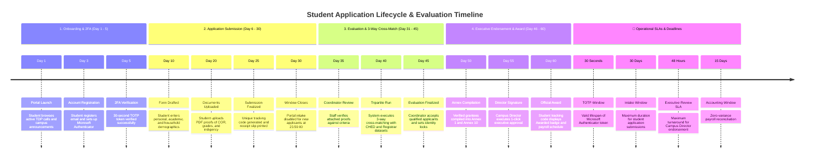

# Student Applicant — Timing Diagram

> **Role:** `STUDENT`  
> **Diagram Type:** Timing Diagram  
> **Scope:** Student Intake Schedule, 2FA Verification Windows, Deadlines & SLAs  
> **Standard:** UML 2.5 Timing & Temporal Specification

---

## 1. Purpose

The Timing Diagram traces the time-based state transitions and administrative service level agreements (SLAs) governing student scholarship intake, 2FA verification windows, evaluation turnarounds, and award notifications in MinSU DocTrack.

---

## 2. Mermaid Timing Diagram

---

## 3. Diagram Legend & Symbol Guide

| Timeline Element | Syntax / Type | Temporal Meaning | MinSU Operational Application |
|---|---|---|---|
| `section Phase Name` | Timeline Section | High-level operational semester phase | Onboarding, Submission Window, Evaluation, Executive Endorsement |
| `Day N : Milestone` | Temporal Milestone | Specific calendar threshold or SLA trigger date | Day 1 (Portal Launch), Day 30 (Intake cutoff), Day 60 (Final award release) |
| `30 Seconds` | Security Token SLA | Ephemeral lifespan of TOTP 2FA code | Time allowed for user to submit Microsoft Authenticator 6-digit code |
| `30 Days` | Application Intake SLA | Hard intake boundary | Public intake portal accepts form data until Day 30 cutoff |
| `48 Hours` | Executive Endorsement SLA | Critical executive turnaround | Maximum time for Campus Director to review and endorse masterlists |

---

## 4. Timeline Milestones & Rules

- **Days 1 to 5 (Onboarding & 2FA)**: Students register their institutional email accounts and pair Microsoft Authenticator via standard 30-second TOTP challenges.
- **Days 6 to 30 (Submission Window)**: Students complete application wizards, upload required proofs, and receive their unique tracking code (`TDP-YYYY-XXXX`).
- **Day 30 (Hard Cutoff)**: Server actions reject incoming application payloads; student submissions become read-only.
- **Days 31 to 45 (Evaluation & 3-Way Match)**: Coordinators inspect attachments and run the tripartite verification engine against CHED and Registrar datasets.
- **Day 60 (Award & Notice Release)**: Approved applicants access digital Notice of Award certificates and view scheduled payroll disbursements.
