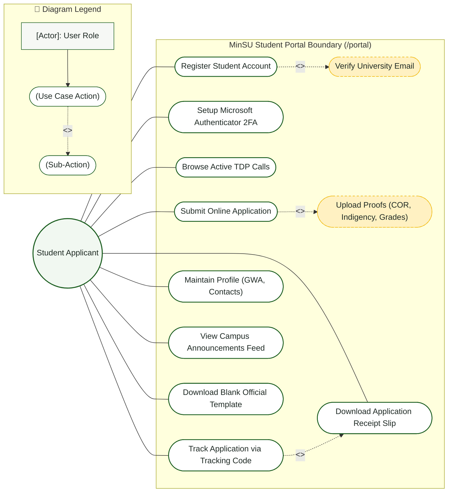
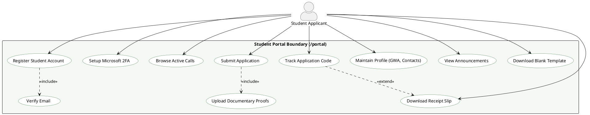

# Student Applicant — Use Case Diagram

> **Role:** `STUDENT`  
> **Diagram Type:** Use Case Diagram  
> **Standard:** UML 2.5 Use Case Specification

---

## 1. Purpose

The Use Case Diagram shows all features accessible to Student Applicants in the MinSU DocTrack Student Portal, including 2FA setup, application submission, profile maintenance, and announcements tracking.

---

## 2. Mermaid Use Case Diagram

---

## 3. Diagram Legend & Symbol Guide

| Visual Symbol | Syntax / Style | UML Use Case Concept | MinSU System Implementation |
|---|---|---|---|
| `actor` / `[Actor]` | External Role | Prospective or enrolled student grantee | Student Applicant |
| `usecase` / `(["(Action)"])` | Use Case Unit | Applicant capability or service | Register, Setup 2FA, Apply Online, Track Code, Update Profile |
| `-->` Solid Arrow | Actor Association | User initiates portal action | Student submits intake form, tracks status, updates phone/GWA |
| `..>` / `-.->` Dashed Arrow | Stereotyped Dependency | Relationship between use cases | `<<include>>` (Mandatory proof upload) or `<<extend>>` (Receipt slip download) |

---

## 4. PlantUML Use Case Diagram

