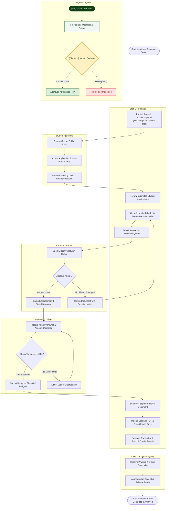

# Activity Diagram: MinSU DocTrack Whole System

## 1. Description
This activity diagram models the end-to-end institutional workflow for the Tulong Dunong Program (TDP) across an entire academic semester. It traces actions, decisions, and handoffs through five swimlanes representing the Student Applicant, Staff Coordinator, Campus Director, Accounting Officer, and CHED Agency.

## 2. ASD-STE100 Technical Specifications
- Organize parallel and sequential actions into explicit actor swimlanes.
- Use diamond nodes for decisions with mutually exclusive guard conditions.
- Synchronize concurrent activities with fork and join bars.
- End all execution branches at terminal final nodes.

---

## 3. Institutional TDP Workflow Diagram (Mermaid)

---

## 4. Diagram Legend & Symbol Guide

| Visual Symbol | Syntax / Node Type | Technical Role | MinSU Domain Meaning |
|---|---|---|---|
| `([Pill Shape])` | `([Start / End])` | Initial or terminal workflow boundary | Academic semester opening & final archive closure |
| `[Rectangle]` | `["Action"]` | Operational process or staff task | Compiling Annex 2, verifying credentials, uploading signed scans |
| `{Diamond}` | `{"Decision"}` | Mutually exclusive condition / guard | "Approve Annex?" (Director) or "Variance == 0.00?" (Accounting) |
| `──▶` | Solid Line `-->` | Sequential flow transition | Standard forward progression between steps |
| `-->\|Label\|` | Guarded Branch | Conditional execution branch | "Yes: Approved", "No: Needs Changes", "Discrepancy" |
| 🔲 Subgraph | `subgraph Lane_Role` | Departmental Swimlane Boundary | Segregates duties between Student, Staff, Director, Accounting, and CHED |
| 🟢 Green Box | `#DCEFDD` / `#1B5E20` | MinSU Approval & Success State | Campus Director endorsement and balanced account records |
| 🟡 Gold Box | `#FFF1C2` / `#B88A00` | Review & Verification Gate | Executive evaluation queue and conditional checks |
| 🔴 Red / Rose Box | `#FEE2E2` / `#DC2626` | Revision & Discrepancy Alert | Document returned for revisions or ledger discrepancy adjustment |

---

## 5. Workflow Stages & Hand-offs
1. **Intake Phase**: The staff coordinator publishes the TDP call. Prospective students register, upload required documents, and receive tracking codes.
2. **Operational Compilation Phase**: The staff coordinator verifies enrollment and grade certificates, compiles the Annex 2 masterlist, and sends it to the executive queue.
3. **Executive Endorsement Phase**: The campus director evaluates the compiled masterlist. If revisions are required, the director returns the record with comments; otherwise, the director stamps approval.
4. **Financial Reconciliation Phase**: The accounting officer compiles the Annex 9 payroll and Annex 6 fund utilization. The system enforces zero variance against government grants before permitting submission.
5. **Transmittal & Dispatch Phase**: The staff coordinator uploads wet-signed physical scans, binds external agency tracking numbers, and transmits the package to CHED.
