# Activity Diagram: MinSU DocTrack Whole System

## 1. Description
This activity diagram models the end-to-end institutional workflow for the Tulong Dunong Program (TDP) across an entire academic semester. It traces actions, decisions, and handoffs through five swimlanes representing the Student Applicant, Staff Coordinator, Campus Director, Accounting Officer, and CHED Agency, incorporating student validation, 3-way verification, executive approval, and multi-tab Excel export.

## 2. ASD-STE100 Technical Specifications
- Organize parallel and sequential actions into explicit actor swimlanes.
- Use diamond nodes for decisions with mutually exclusive guard conditions.
- Synchronize concurrent activities with fork and join bars.
- End all execution branches at terminal final nodes.

---

## 3. Institutional TDP Workflow Diagram (Mermaid)

```mermaid
graph TD
    %% Initial Node
    StartNode([Start: Academic Semester Begins]) --> A1

    subgraph Lane_Staff ["Staff Coordinator"]
        A1["Publish Annex 2 Scholarship Call<br/>(Set slot quota & cutoff date)"]
        A4["Validate Student Registrations in Queue<br/>(Mark ACCEPTED or REJECTED)"]
        A4_Verify["Execute 3-Way Tripartite Verification<br/>(Upload CHED & Registrar CSVs)"]
        D_Verify{"Discrepancies Found?"}
        A4_Resolve["Manually Resolve Discrepancy<br/>(CONFIRM / DISMISS)"]
        A5["Compile Verified Grantees into Annex 4 Billing"]
        A6["Submit Annex 4 to Executive Queue"]
        A12["Scan Wet-Signed Physical Document"]
        A13["Upload Scanned PDF & Sync Google Drive"]
        A14["Package Transmittal & Record Courier Details"]
    end

    subgraph Lane_Student ["Student Applicant"]
        A2["Browse Call on Public Portal"]
        A3["Submit Application Form & Proof Scans"]
        A3_Receipt["Receive Tracking Code & Printable Receipt"]
        A3_Lock["Profile Identity Locked per RA 10173<br/>(GWA and contacts remain editable)"]
    end

    subgraph Lane_Director ["Campus Director"]
        A7["Open Executive Review Queue"]
        D1{"Does Director Approve Annex?"}
        A8["Stamp Endorsement & Digital Signature"]
        A9["Return Document with Revision Notes"]
    end

    subgraph Lane_Accounting ["Accounting Officer"]
        A10["Prepare Annex 9 Payroll & Annex 6 Utilization"]
        D2{"Is Variance == 0.00 PHP?"}
        A11["Submit Balanced Financial Ledgers"]
        A10_Fix["Adjust Ledger Discrepancy"]
        A10_Excel["Export Multi-Tab Excel (.xlsx) Ledgers"]
    end

    subgraph Lane_Agency ["CHED / External Agency"]
        A15["Receive Physical & Digital Transmittal"]
        A16["Acknowledge Receipt & Release Funds"]
    end

    %% Flow Connections
    A1 --> A2
    A2 --> A3
    A3 --> A3_Receipt
    A3_Receipt --> A4
    A4 --> A3_Lock
    A3_Lock --> A4_Verify
    A4_Verify --> D_Verify
    D_Verify -->|Yes| A4_Resolve
    A4_Resolve --> A5
    D_Verify -->|No| A5
    A5 --> A6
    A6 --> A7
    A7 --> D1
    D1 -->|Yes| A8
    D1 -->|No| A9
    A9 --> A5
    A8 --> A12
    A12 --> A13
    A13 --> A14
    A14 --> A15
    A15 --> A16
    A16 --> A10
    A10 --> D2
    D2 -->|Yes| A11
    D2 -->|No| A10_Fix
    A10_Fix --> A10
    A11 --> A10_Excel
    A10_Excel --> EndNode([End: Semester Grant Disbursed & Liquidated])

    %% ─── 📌 VISUAL LEGEND ───
    subgraph Legend ["📌 Diagram Legend"]
        direction TB
        L_Action["[Process Step]: System Activity"]
        L_Decision{"{Decision Node}: Conditional Guard"}
        L_Terminal([Start / End Boundary])
        L_Action --> L_Decision
    end
```

---

## 4. Diagram Legend & Symbol Guide

| Visual Symbol | UML Activity Concept | MinSU Domain Meaning |
|---|---|---|
| `([Pill Shape])` | Initial / Final Node | Semester cycle starts or fund disbursement concludes |
| `[Rectangle]` | Action State | Publish call, validate registrations, run 3-way match, export Excel |
| `{Diamond}` | Decision / Guard | Discrepancy check, Director approval decision, zero-variance test |
| `Swimlanes` | Partition Boundaries | Segregates actions by Student, Staff, Director, Accounting, and CHED |
