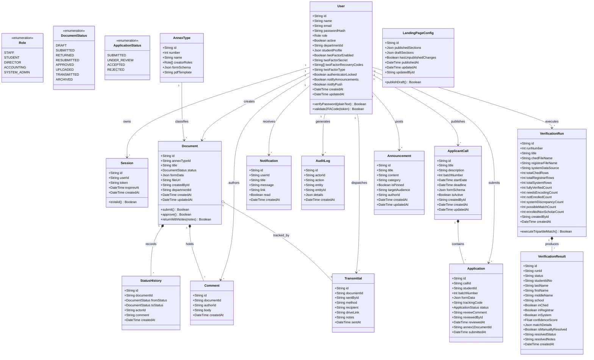
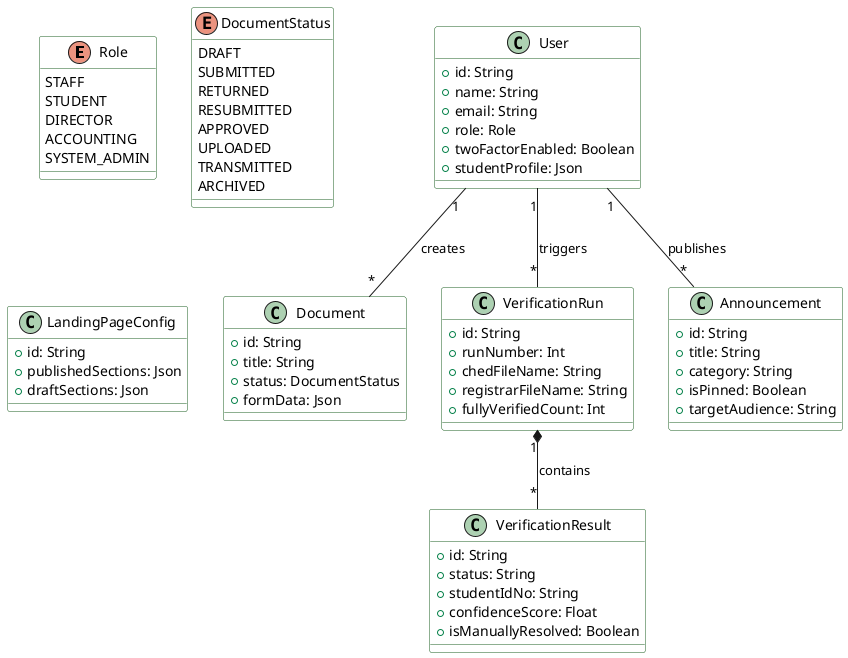

# Class Diagram

> **System:** MinSU DocTrack  
> **Diagram Type:** Class Diagram  
> **Standard:** UML 2.5 Class Specification

---

## 1. Purpose

The Class Diagram shows the domain models, attributes, operations, and relationships in the MinSU DocTrack persistence layer. It shows core documents, users, sessions, verification runs, announcements, landing CMS configs, and audit records.

---

## 2. Mermaid Class Diagram

---

## 3. Diagram Legend & Symbol Guide

| Visual Symbol | Syntax / Style | UML Concept | MinSU Domain Meaning |
|---|---|---|---|
| `Class` | `class Name` | Domain Model | Persistent entity backed by PostgreSQL Prisma schema |
| `Enumeration` | `<<enumeration>>` | Type Constants | System roles, document states, application review decisions |
| `-->` | Directed Association | Unidirectional pointer | User owns sessions, authors comments, receives notifications |
| `*--` | Composition | Strict ownership | Document owns StatusHistory; VerificationRun owns VerificationResults |
| `o--` | Aggregation | Weak ownership | Document is optionally associated with an Outgoing Transmittal |

---

## 4. PlantUML Class Diagram

