# Class Diagram

> **System:** MinSU DocTrack  
> **Diagram Type:** Class Diagram  
> **Standard:** UML 2.5 Class Specification

---

## 1. Purpose

The Class Diagram shows the domain models, attributes, operations, and relationships in the MinSU DocTrack persistence layer.

---

## 2. Mermaid Class Diagram

```mermaid
classDiagram
    direction TB

    class Role {
        <<enumeration>>
        STAFF
        STUDENT
        DIRECTOR
        ACCOUNTING
        SYSTEM_ADMIN
    }

    class DocumentStatus {
        <<enumeration>>
        DRAFT
        SUBMITTED
        RETURNED
        RESUBMITTED
        APPROVED
        UPLOADED
        TRANSMITTED
        ARCHIVED
    }

    class ApplicationStatus {
        <<enumeration>>
        SUBMITTED
        UNDER_REVIEW
        ACCEPTED
        REJECTED
    }

    class User {
        +String id
        +String name
        +String email
        +String passwordHash
        +Role role
        +Boolean active
        +String departmentId
        +DateTime createdAt
        +DateTime updatedAt
        +verifyPassword(plainText) Boolean
        +hasPermission(action) Boolean
    }

    class Session {
        +String id
        +String userId
        +String token
        +DateTime expiresAt
        +DateTime createdAt
        +isExpired() Boolean
    }

    class AnnexType {
        +String id
        +Int number
        +String name
        +Role[] creatorRoles
        +Json formSchema
        +String pdfTemplate
        +canCreate(role) Boolean
    }

    class Document {
        +String id
        +String annexTypeId
        +String title
        +DocumentStatus status
        +Json formData
        +String fileUrl
        +String createdById
        +String departmentId
        +DateTime createdAt
        +DateTime updatedAt
        +transitionTo(newStatus, actorId, comment) StatusHistory
        +validateFormData() Boolean
    }

    class StatusHistory {
        +String id
        +String documentId
        +DocumentStatus fromStatus
        +DocumentStatus toStatus
        +String actorId
        +String comment
        +DateTime createdAt
    }

    class Comment {
        +String id
        +String documentId
        +String authorId
        +String body
        +DateTime createdAt
    }

    class Transmittal {
        +String id
        +String documentId
        +String sentById
        +String method
        +String recipient
        +String driveLink
        +String notes
        +DateTime sentAt
    }

    class ApplicantCall {
        +String id
        +String title
        +String description
        +DateTime deadline
        +Json formSchema
        +Boolean isActive
        +String createdById
        +DateTime createdAt
        +DateTime updatedAt
        +isOpen() Boolean
    }

    class Application {
        +String id
        +String callId
        +String studentId
        +Json formData
        +String trackingCode
        +ApplicationStatus status
        +String reviewComment
        +String reviewedById
        +DateTime reviewedAt
        +String annex1DocumentId
        +DateTime submittedAt
        +evaluate(status, comment, reviewerId) Void
    }

    class Notification {
        +String id
        +String userId
        +String title
        +String message
        +String link
        +Boolean read
        +DateTime createdAt
        +markAsRead() Void
    }

    class AuditLog {
        +String id
        +String actorId
        +String action
        +String entity
        +String entityId
        +Json details
        +DateTime createdAt
    }

    class LandingPageConfig {
        +String id
        +Json publishedSections
        +Json draftSections
        +Boolean hasUnpublishedChanges
        +DateTime publishedAt
        +DateTime updatedAt
        +String updatedById
        +publish() Void
    }

    %% Relationships
    User "1" -- "0..*" Session : has
    User "1" -- "0..*" Document : creates
    User "1" -- "0..*" Comment : authors
    User "1" -- "0..*" Notification : receives
    User "1" -- "0..*" AuditLog : triggers
    User "1" -- "0..*" Application : applies as student
    User "1" -- "0..*" ApplicantCall : publishes as staff
    User "1" -- "0..*" Transmittal : dispatches

    AnnexType "1" -- "0..*" Document : defines schema for

    Document "1" *-- "0..*" StatusHistory : records
    Document "1" *-- "0..*" Comment : contains
    Document "1" *-- "0..1" Transmittal : dispatched via

    ApplicantCall "1" *-- "0..*" Application : receives
    Document "0..1" ..> Application : compiles accepted into Annex 1

    User ..> Role : uses
    Document ..> DocumentStatus : transitions
    Application ..> ApplicationStatus : evaluates

    %% ─── 📌 VISUAL LEGEND ───
    note "<b>📌 DIAGRAM LEGEND & UML NOTATION</b>\n+ Public Property / Function\n- Private / Internal Field\n*-- Strong Composition (Cascade Delete)\n-- Multiplicity Association (1 to Many)\n..> Dependency / Uses State\n&lt;&lt;enumeration&gt;&gt; Strict Enum Domain"
```

---

## 3. Diagram Legend & Symbol Guide

| Symbol / UML Notation | Meaning & Syntax | Technical Function | MinSU Domain Example |
|---|---|---|---|
| `+` | Public Visibility | Readable attribute or callable method | `+verifyPassword()`, `+name`, `+email` |
| `-` | Private Visibility | Encapsulated field | System security attributes and hashed credentials |
| `<<enumeration>>` | Enum Classifier | Strict closed set of categorical values | `Role` (`DIRECTOR`, `STAFF`), `DocumentStatus` (`APPROVED`, `SUBMITTED`) |
| `*--` | Strong Composition | Lifecycle containment (child deleted on parent deletion) | `Document *-- StatusHistory`, `Document *-- Comment` |
| `o--` | Weak Aggregation | Referenced association without ownership | Auxiliary references |
| `--` | Association (`"1" -- "0..*"`) | Multiplicity mapping between database entities | `User "1" -- "0..*" Document` (One coordinator creates many documents) |
| `..>` | Dependency | Usage or transition relationship | `Document ..> DocumentStatus` (Document lifecycle changes) |

---

## 4. Multiplicity & Integrity Constraints

- Every `Session` belongs to exactly one `User`.
- A `Document` must reference one `AnnexType` schema.
- When a `Document` is deleted, its `StatusHistory`, `Comment`, and `Transmittal` records delete automatically (Cascade).
- An `Application` has a unique `trackingCode` for public verification.
