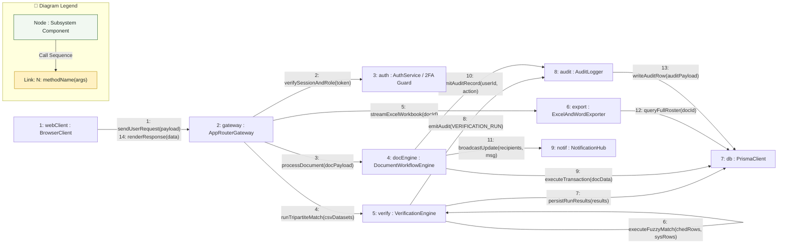

# Communication Diagram: MinSU DocTrack Whole System

## 1. Description
This communication diagram visualizes the structural links and sequenced messages exchanged between core software subsystems across MinSU DocTrack. It highlights message traffic density, inter-service coordination, verification workflows, and document generation during peak operations.

## 2. ASD-STE100 Technical Specifications
- Number messages sequentially to indicate invocation order.
- Connect interacting subsystems with explicit communication links.
- Emphasize high-volume collaboration between controllers, engines, and persistence adapters.

---

## 3. System Communication Diagram (Mermaid)

---

## 4. Diagram Legend & Symbol Guide

| Element | Format / Syntax | Technical Meaning | MinSU Implementation Context |
|---|---|---|---|
| Subsystem Node | `[N: name : Class]` | Structural software participant | `AppRouterGateway`, `VerificationEngine`, `PrismaClient` |
| Link Connector | `-- "..." -->` | Directed communication channel | HTTP request, RPC method call, or database query |
| Numbered Prefix | `1:`, `2:`, `14:` | Chronological message sequence number | Order of execution from user trigger to database write and UI response |
