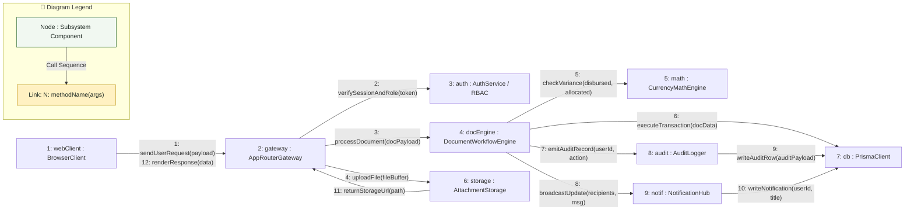

# Communication Diagram: MinSU DocTrack Whole System

## 1. Description
This communication diagram visualizes the structural links and sequenced messages exchanged between core software subsystems across MinSU DocTrack. It highlights message traffic density, inter-service coordination, and data mutation paths during peak operations.

## 2. ASD-STE100 Technical Specifications
- Number messages sequentially to indicate invocation order.
- Connect interacting subsystems with explicit communication links.
- Emphasize high-volume collaboration between controllers, engines, and persistence adapters.

---

## 3. System Communication Diagram (Mermaid)

---

## 4. Diagram Legend & Symbol Guide

| Element | Format / Syntax | Technical Meaning | MinSU Implementation Context |
|---|---|---|---|
| Subsystem Node | `[N: name : Class]` | Structural software participant | `AppRouterGateway`, `AuthService`, `PrismaClient` |
| Link Connector | `-- "..." -->` | Directed communication channel | HTTP request, RPC method call, or database query |
| Numbered Prefix | `1:`, `2:`, `12:` | Chronological message sequence number | Order of execution from user trigger to database write and UI response |
| Method Signature | `methodName(params)` | Invoked operation contract | `verifySessionAndRole(token)`, `checkVariance()`, `writeAuditRow()` |
| 🟢 Green Tone | `#F1F8F1` / `#1B5E20` | Core Internal Service | MinSU institutional workflow & database handlers |
| 🟡 Gold Tone | `#FFF1C2` / `#B88A00` | Security & Dispatch Hub | RBAC verification & notification broadcast |

---

## 5. Message Invocation Flow
- **Messages 1–2**: Inbound client requests are authenticated by the `AppRouterGateway` through the `AuthService` using cryptographically secure session cookies.
- **Message 3–4**: Validated requests pass to the `DocumentWorkflowEngine`, while binary attachments route to `AttachmentStorage`.
- **Message 5**: For financial annexes (Annex 6–9), the engine requests balance verification from `CurrencyMathEngine`.
- **Message 6–8**: The engine commits document state changes to `PrismaClient`, emits an immutable audit event to `AuditLogger`, and dispatches updates via `NotificationHub`.
- **Message 9–10**: Security audits and user notifications persist directly into relational database tables.
- **Message 11–12**: Storage URLs and updated document payloads return to the client browser for rendering.
