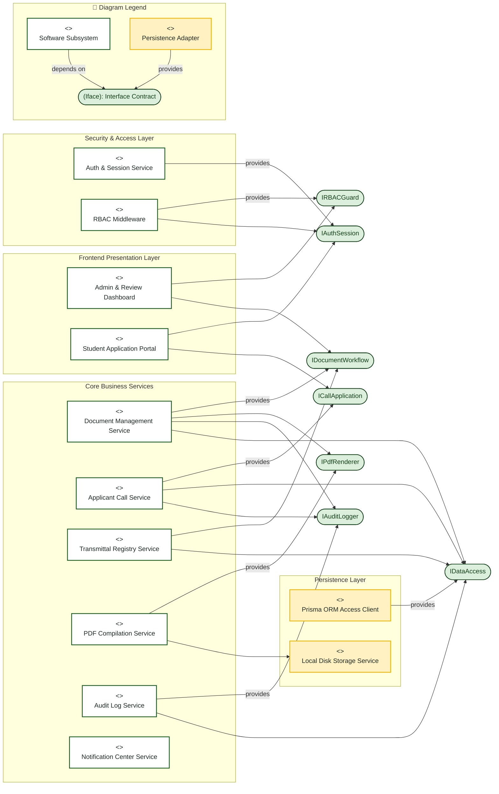
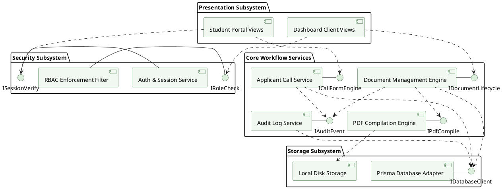

# Component Diagram

> **System:** MinSU DocTrack  
> **Diagram Type:** Component Diagram  
> **Standard:** UML 2.5 Component Specification

---

## 1. Purpose

The Component Diagram shows the software subsystems, modules, and interfaces within MinSU DocTrack. It shows how modules depend on interfaces to process requests.

---

## 2. Mermaid Component Diagram

---

## 3. Diagram Legend & Symbol Guide

| Visual Symbol | Syntax / Style | Technical Role | MinSU Architecture Mapping |
|---|---|---|---|
| `<<component>>` Box | `fill:#FFFFFF, stroke:#1B5E20` | Architectural subsystem or service module | Next.js Views, AuthService, DocumentService, AuditService |
| `([Interface Circle])` | `fill:#DCEFDD, stroke:#123F17` | Provided / Required Interface Contract | `IAuthSession`, `IRBACGuard`, `IDocumentWorkflow`, `IDataAccess` |
| 🟨 Data Component | `fill:#FFF1C2, stroke:#F2B705` | Persistence & Storage adapter component | Prisma ORM Client, Local Disk / Cloud Blob Storage |
| `-->` Solid Arrow | Dependency / Consumer | Module calls or requires the interface | `DashboardUI --> IRBAC`, `CallService --> IData` |
| `-- provides -->` | Realization / Provider | Module implements or provides the interface | `DocumentService -- provides --> IDoc`, `PrismaService -- provides --> IData` |
| Boundary Subgraph | `subgraph LAYER` | Architectural tier / layer grouping | Presentation, Security, Core Business, and Persistence Layers |

---

## 4. PlantUML Component Diagram

---

## 5. Component Rules & Coupling

- Modules communicate through explicit TypeScript interfaces and function boundaries.
- No circular dependencies exist between business services.
- The `Audit Log Service` records every status modification without coupling to UI components.
- The `PDF Compilation Engine` accepts pure JSON input data and produces standards-compliant PDF streams.
