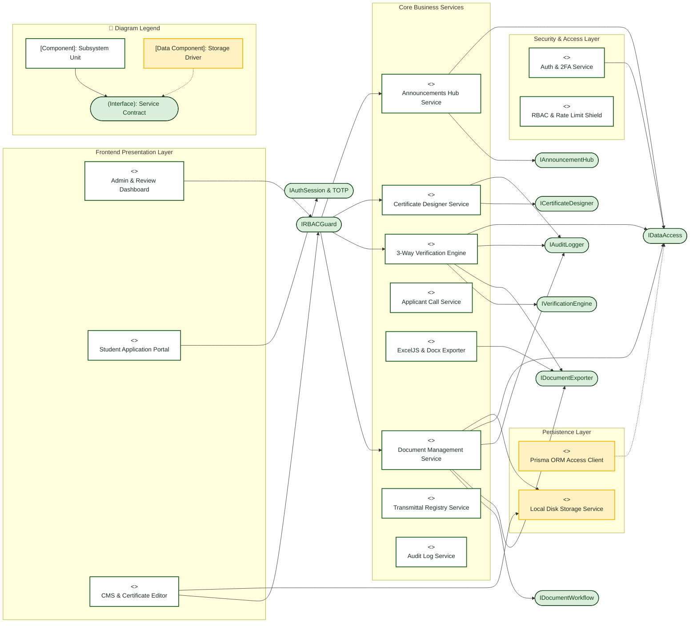
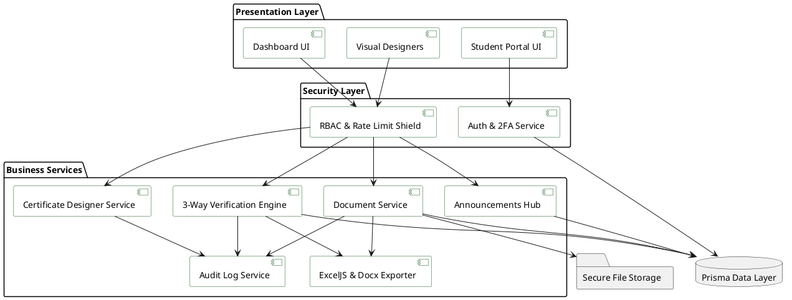

# Component Diagram

> **System:** MinSU DocTrack  
> **Diagram Type:** Component Diagram  
> **Standard:** UML 2.5 Component Specification

---

## 1. Purpose

The Component Diagram shows the software subsystems, modules, and interfaces within MinSU DocTrack. It shows how modules depend on interfaces to process requests.

---

## 2. Mermaid Component Diagram

---

## 3. Diagram Legend & Symbol Guide

| Visual Symbol | Syntax / Style | UML Component Concept | MinSU Application |
|---|---|---|---|
| `Component` | `["<<component>> Name"]` | Software module | Verification Engine, Document Service, Auth Service, Exporter |
| `Interface` | `(["IName"])` | Service API contract | `IVerificationEngine`, `IDocumentWorkflow`, `IAuthSession` |
| `Dependency` | `-->` / `-.->` | Module dependency | Dashboard relies on RBAC; Document Engine invokes Audit Logger |

---

## 4. PlantUML Component Diagram

