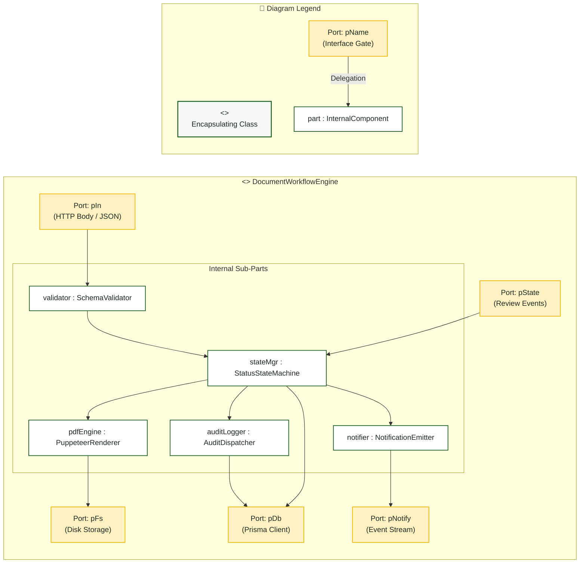

# Composite Structure Diagram

> **System:** MinSU DocTrack  
> **Diagram Type:** Composite Structure Diagram  
> **Classifier:** `DocumentWorkflowEngine`

---

## 1. Purpose

The Composite Structure Diagram shows the internal parts, ports, and connectors of the `DocumentWorkflowEngine`. It shows how internal parts collaborate to process TDP Annex documents.

---

## 2. Diagram & Internal Structure

---

## 3. Diagram Legend & Symbol Guide

| Visual Symbol | Syntax / Style | UML Structural Role | MinSU System Implementation |
|---|---|---|---|
| Outer Classifier | `subgraph ENGINE` (`#F6F8F6`) | Encapsulating software unit | `DocumentWorkflowEngine` containing internal TDP workflow logic |
| 🟨 Port Node | `pName` (`#FFF1C2` / `#F2B705`) | Interaction boundary / gate | `pIn` (HTTP JSON), `pState` (Review triggers), `pDb` (Prisma queries) |
| ⬜ Internal Part | `part : Class` (`#FFFFFF` / `#1B5E20`) | Component instance owned by classifier | `validator`, `stateMgr`, `pdfEngine`, `auditLogger`, `notifier` |
| `-->` Connector | Solid Arrow | Internal message connector or port delegation | Linking external ports to internal validators and persistent adapters |

---

## 4. Parts, Ports, and Connectors Table

| Element Name | Type | Multiplicity | Role / Description |
|---|---|---|---|
| `pIn` | Port | `1` | Receives client form submissions and file upload payloads. |
| `pState` | Port | `1` | Receives state change commands (Submit, Approve, Return, Archive). |
| `pDb` | Port | `1` | Dispatches database read/write queries to Prisma ORM. |
| `pFs` | Port | `1` | Streams binary PDF scans to persistent host storage. |
| `pNotify` | Port | `1` | Transmits in-app alerts to users when document statuses update. |
| `validator` | Part (`SchemaValidator`) | `1` | Validates document JSON against the Zod schema for that Annex number. |
| `stateMgr` | Part (`StatusStateMachine`) | `1` | Enforces valid status transitions and verifies actor permissions. |
| `pdfEngine` | Part (`PuppeteerRenderer`) | `1` | Compiles structured data into official CHED/MinSU formatted PDF files. |
| `auditLogger` | Part (`AuditDispatcher`) | `1` | Generates immutable audit entries for each transaction. |
| `notifier` | Part (`NotificationEmitter`) | `1` | Alerts reviewers and preparers when documents require action. |

---

## 5. STE Rules Applied

- The diagram focuses on one classifier: the `DocumentWorkflowEngine`.
- External interactions enter and exit through clearly named ports.
- Internal parts communicate through typed connectors.
