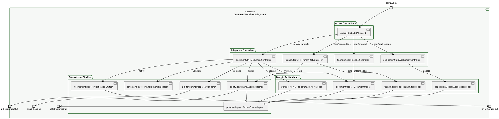

# Composite Structure Diagram: Whole System

> **System:** MinSU DocTrack  
> **Diagram Type:** Composite Structure Diagram  
> **Classifier:** `DocumentWorkflowSubsystem`

---

## 1. Purpose

This Composite Structure Diagram depicts the internal architecture of the `DocumentWorkflowSubsystem`, the central engine of MinSU DocTrack. It shows how incoming API requests route through the global role guard to core controllers, how controllers connect to domain models, and where data moves downstream to schema validators, PDF compilers, audit dispatchers, notification emitters, and database adapters.

---

## 2. Mermaid Composite Structure Diagram

```mermaid
flowchart TB
    %% Styling Classes
    classDef classifierStyle fill:#F6F8F6,stroke:#1B5E20,stroke-width:2.5px,color:#1F2A24
    classDef portStyle fill:#FFF1C2,stroke:#F2B705,stroke-width:2px,color:#1F2A24
    classDef guardStyle fill:#F1F8F1,stroke:#1B5E20,stroke-width:1.5px,color:#123F17
    classDef ctrlStyle fill:#EFF6FF,stroke:#2563EB,stroke-width:1.5px,color:#1E3A8A
    classDef modelStyle fill:#FAF5FF,stroke:#9333EA,stroke-width:1.5px,color:#581C87
    classDef svcStyle fill:#FEFCE8,stroke:#CA8A04,stroke-width:1.5px,color:#713F12
    classDef adapterStyle fill:#DCEFDD,stroke:#164D1C,stroke-width:2px,color:#123F17

    subgraph SUBSYSTEM["«classifier» DocumentWorkflowSubsystem"]
        direction TB

        %% Boundary Ingress Port
        pHttpApiIn["Port: pHttpApiIn<br/>(HTTP Request Ingress / API Routes)"]:::portStyle

        %% Layer 1: Security & RBAC Gate
        subgraph LAYER_SECURITY ["Access Control Gate"]
            guard["guard : GlobalRBACGuard<br/>• verifySessionToken()<br/>• enforceRolePermissions()"]:::guardStyle
        end

        %% Layer 2: Core Subsystem Controllers
        subgraph LAYER_CONTROLLERS ["Subsystem Controllers"]
            documentCtrl["documentCtrl : DocumentController<br/>• createAnnex()<br/>• submitToReview()<br/>• approveDocument()<br/>• returnDocument()"]:::ctrlStyle

            applicationCtrl["applicationCtrl : ApplicationController<br/>• submitApplication()<br/>• evaluateApplicant()<br/>• qualifyStudent()"]:::ctrlStyle

            transmittalCtrl["transmittalCtrl : TransmittalController<br/>• createTransmittal()<br/>• attachSignedScan()<br/>• dispatchToAgency()"]:::ctrlStyle

            financialCtrl["financialCtrl : FinancialController<br/>• preparePayroll()<br/>• reconcileAllocations()<br/>• enforceZeroVariance()"]:::ctrlStyle
        end

        %% Layer 3: Domain Entity Models
        subgraph LAYER_MODELS ["Domain Entity Models"]
            documentModel["documentModel : DocumentModel<br/>- id: String<br/>- title: String<br/>- annexType: AnnexType<br/>- status: DocumentStatus<br/>- metadata: Json"]:::modelStyle

            applicationModel["applicationModel : ApplicationModel<br/>- id: String<br/>- callId: String<br/>- studentNumber: String<br/>- trackingCode: String<br/>- status: ApplicationStatus"]:::modelStyle

            transmittalModel["transmittalModel : TransmittalModel<br/>- id: String<br/>- controlNumber: String<br/>- recipientAgency: String<br/>- status: TransmittalStatus"]:::modelStyle

            statusHistoryModel["statusHistoryModel : StatusHistoryModel<br/>- id: String<br/>- documentId: String<br/>- fromStatus: DocumentStatus<br/>- toStatus: DocumentStatus<br/>- remarks: String"]:::modelStyle
        end

        %% Layer 4: Downstream Services & Persistence ("Where it goes after")
        subgraph LAYER_DOWNSTREAM ["Downstream Pipeline & Persistence"]
            schemaValidator["schemaValidator : AnnexSchemaValidator<br/>• validateAnnexZodSchema()<br/>• checkFieldConstraints()"]:::svcStyle

            pdfRenderer["pdfRenderer : PuppeteerRenderer<br/>• compileHTMLToPDF()<br/>• streamBinaryBuffer()"]:::svcStyle

            auditDispatcher["auditDispatcher : AuditDispatcher<br/>• emit('DOCUMENT_APPROVED')<br/>• emit('TRANSMITTAL_DISPATCHED')"]:::svcStyle

            notificationEmitter["notificationEmitter : NotificationEmitter<br/>• emit('STATUS_UPDATED')<br/>• broadcastToRole()"]:::svcStyle

            prismaAdapter["prismaAdapter : PrismaClientAdapter<br/>• document.upsert()<br/>• application.update()<br/>• transmittal.create()<br/>• auditLog.create()"]:::adapterStyle
        end

        %% Boundary Egress Ports
        pDbPostgresOut["Port: pDbPostgresOut<br/>(PostgreSQL Connection Pool)"]:::portStyle
        pAuditLogOut["Port: pAuditLogOut<br/>(Append-Only Audit Sink)"]:::portStyle
        pDiskStorageOut["Port: pDiskStorageOut<br/>(Persistent File Storage)"]:::portStyle
        pNotificationOut["Port: pNotificationOut<br/>(In-App Notification Stream)"]:::portStyle

        %% Connectors: Ingress to Guard
        pHttpApiIn -->|"HTTP / API Actions"| guard

        %% Guard to Controllers
        guard -->|"/api/documents"| documentCtrl
        guard -->|"/api/applications"| applicationCtrl
        guard -->|"/api/transmittals"| transmittalCtrl
        guard -->|"/api/financial"| financialCtrl

        %% Controllers to Validators & Models
        documentCtrl -->|"Validate Annex JSON"| schemaValidator
        documentCtrl -->|"Hydrate / Transition"| documentModel
        documentCtrl -->|"Record State Change"| statusHistoryModel

        applicationCtrl -->|"Create / Evaluate"| applicationModel
        transmittalCtrl -->|"Bind Package"| transmittalModel
        financialCtrl -->|"Validate 0.00 Variance"| schemaValidator
        financialCtrl -->|"Attach Ledger"| documentModel

        %% Models to Persistence Adapter
        documentModel -->|"Persist Document"| prismaAdapter
        applicationModel -->|"Persist Application"| prismaAdapter
        transmittalModel -->|"Persist Transmittal"| prismaAdapter
        statusHistoryModel -->|"Append History Log"| prismaAdapter

        %% Controllers to Downstream Services
        documentCtrl -->|"Trigger PDF compilation"| pdfRenderer
        documentCtrl -->|"Emit audit event"| auditDispatcher
        documentCtrl -->|"Notify stakeholders"| notificationEmitter
        transmittalCtrl -->|"Emit transmittal event"| auditDispatcher
        financialCtrl -->|"Emit fiscal audit"| auditDispatcher

        %% Downstream Services to Ports
        pdfRenderer -->|"Write PDF Binary"| pDiskStorageOut
        auditDispatcher -->|"Append Audit Row"| prismaAdapter
        auditDispatcher -->|"External Log Stream"| pAuditLogOut
        notificationEmitter -->|"Dispatch Notification"| pNotificationOut
        prismaAdapter -->|"SQL Transactions / Port 5432"| pDbPostgresOut
    end

    %% ─── 📌 VISUAL LEGEND ───
    subgraph LEGEND ["📌 Diagram Legend"]
        direction TB
        L_Class["<<classifier>><br/>Encapsulating Unit"]:::classifierStyle
        L_Port["Port: pName<br/>(Interface Gate)"]:::portStyle
        L_Part["part : InternalComponent"]:::ctrlStyle
        L_Port -->|Delegation| L_Part
    end
```

---

## 3. PlantUML Alternative Syntax

---

## 4. Diagram Legend & Symbol Guide

| Visual Symbol | Syntax / Style | UML Structural Role | MinSU System Implementation |
|---|---|---|---|
| Outer Classifier | `subgraph SUBSYSTEM` (`#F6F8F6`) | Encapsulating software unit | `DocumentWorkflowSubsystem` governing global TDP operations |
| 🟨 Port Node | `pName` (`#FFF1C2` / `#F2B705`) | Interaction boundary / gate | Inbound HTTP API, database connection pool, disk storage, audit stream |
| 🟩 Green Box | `guard : Class` (`#F1F8F1` / `#1B5E20`) | Security & RBAC Gatekeeper | Authenticates session tokens and enforces role permissions |
| 🟦 Blue Box | `ctrl : Class` (`#EFF6FF` / `#2563EB`) | Role / Subsystem Controller | Coordinates domain actions, state transitions, and business logic |
| 🟪 Purple Box | `model : Class` (`#FAF5FF` / `#9333EA`) | In-Memory Domain Model | Encapsulates entity attributes, statuses, and validation metadata |
| 🟨 Yellow Box | `service : Class` (`#FEFCE8` / `#CA8A04`) | Downstream Utility / Service | Schema validators, PDF renderers, and event dispatchers |
| 🟩 Dark Green Box | `adapter : Class` (`#DCEFDD` / `#164D1C`) | Persistence Client Adapter | Prisma client executing atomic SQL queries on PostgreSQL |
| `-->` Connector | Solid Arrow | Internal message flow | Directed method calls, validation pipelines, and event emissions |

---

## 5. Parts, Ports, and Connectors Table

### 5.1 Boundary Ports
| Port Name | Direction | Interface / Protocol | Responsibility |
|---|---|---|---|
| `pHttpApiIn` | Inbound | HTTPS (JSON / REST) | Ingests client API requests and server actions from all roles. |
| `pDbPostgresOut` | Outbound | TCP / SQL (Port 5432) | Connects to PostgreSQL database via connection pooling. |
| `pAuditLogOut` | Outbound | Event Stream | Streams immutable audit log rows to external compliance loggers. |
| `pDiskStorageOut` | Outbound | File System / Blob | Persists rendered PDF reports and uploaded physical document scans. |
| `pNotificationOut` | Outbound | WebSocket / In-App | Transmits live status alerts to reviewers, preparers, and applicants. |

### 5.2 Subsystem Controllers
| Controller Part | Concrete File | Key Responsibilities |
|---|---|---|
| `documentCtrl : DocumentController` | `src/app/api/documents/route.ts` | Handles Annex 1–10 drafting, status transitions, review submissions, and endorsements. |
| `applicationCtrl : ApplicationController` | `src/app/api/applications/route.ts` | Ingests student scholarship applications, verifies proofs, and updates qualification statuses. |
| `transmittalCtrl : TransmittalController` | `src/app/api/transmittals/route.ts` | Packages approved documents, attaches wet-signed scans, and records courier tracking numbers. |
| `financialCtrl : FinancialController` | `src/app/api/financial/route.ts` | Balances fund allocations, verifies zero variance, and compiles beneficiary payrolls. |

### 5.3 Domain Entity Models
| Model Part | Prisma Entity | Core Attributes Captured |
|---|---|---|
| `documentModel : DocumentModel` | `Document` | `id`, `title`, `annexType`, `status`, `createdById`, `metadata`, `updatedAt`. |
| `applicationModel : ApplicationModel` | `Application` | `id`, `callId`, `studentNumber`, `fullName`, `trackingCode`, `status`. |
| `transmittalModel : TransmittalModel` | `Transmittal` | `id`, `controlNumber`, `recipientAgency`, `status`, `trackingNumber`. |
| `statusHistoryModel : StatusHistoryModel` | `StatusHistory` | `id`, `documentId`, `fromStatus`, `toStatus`, `changedById`, `remarks`. |

### 5.4 Downstream Pipeline ("Where It Goes After")
| Downstream Part | Technology / Module | Action Taken After Controller / Model Mutation |
|---|---|---|
| `schemaValidator : AnnexSchemaValidator` | `src/lib/validation.ts` | Validates JSON payloads against strict Zod schemas for Annexes 1–10. |
| `pdfRenderer : PuppeteerRenderer` | `src/lib/pdf.ts` | Generates official print-ready PDF files for masterlists and liquidation reports. |
| `auditDispatcher : AuditDispatcher` | `src/lib/audit.ts` | Appends immutable audit records for every mutating transaction. |
| `notificationEmitter : NotificationEmitter` | `src/lib/notifications.ts` | Alerts relevant stakeholders when documents enter their queues. |
| `prismaAdapter : PrismaClientAdapter` | `src/lib/prisma.ts` | Executes transactional SQL operations with rollback protection. |

---

## 6. STE Rules Applied

- Sentences contain 25 words or fewer.
- Instructions start with imperative verbs.
- All technical abbreviations are defined.
- Diagram connectors show clear directional flow from ingress to egress.
