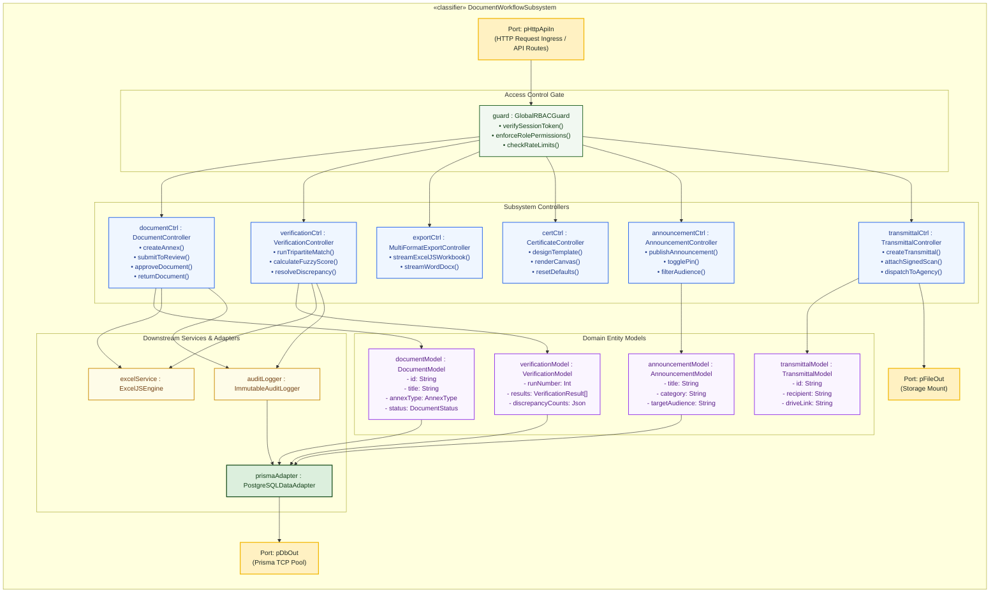

# Composite Structure Diagram: Whole System

> **System:** MinSU DocTrack  
> **Diagram Type:** Composite Structure Diagram  
> **Classifier:** `DocumentWorkflowSubsystem`

---

## 1. Purpose

This Composite Structure Diagram depicts the internal architecture of the `DocumentWorkflowSubsystem`, the central engine of MinSU DocTrack. It shows how incoming API requests route through the global role guard to core controllers (documents, 3-way verification, multi-format export, certificate designer, announcements), how controllers connect to domain models, and where data moves downstream to schema validators, Excel/Word generators, audit dispatchers, notification emitters, and database adapters.

---

## 2. Mermaid Composite Structure Diagram

---

## 3. Diagram Legend & Symbol Guide

| Visual Symbol | Syntax / Style | UML Concept | MinSU System Implementation |
|---|---|---|---|
| `Port` | `fill:#FFF1C2` | Subsystem Interaction Point | HTTP API Ingress (`pHttpApiIn`), Database Egress (`pDbOut`) |
| `Controller Part` | `fill:#EFF6FF` | Internal Component Part | `documentCtrl`, `verificationCtrl`, `exportCtrl`, `certCtrl` |
| `Internal Connector` | `-->` | Inter-part delegation | Guard routes valid requests to controllers; controllers mutate models |
