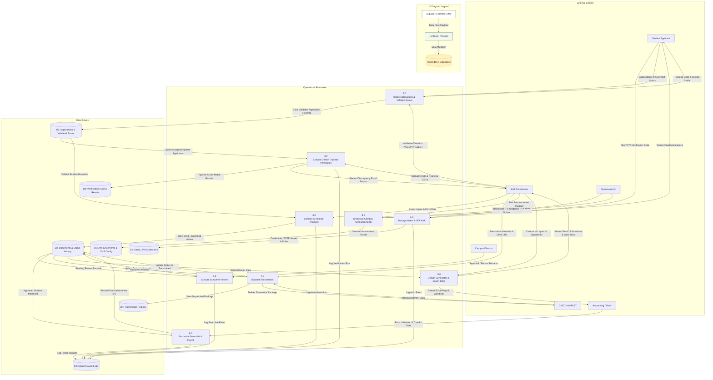

# Data Flow Diagram (DFD): MinSU DocTrack Whole System

## 1. Description
This Data Flow Diagram documents the flow of information across the entire MinSU DocTrack system. It contains the Level 0 Context Diagram and the Level 1 System Data Flow Diagram, mapping data pipelines between external entities, business processes, and data stores including 3-way verification and multi-format document generation.

## 2. ASD-STE100 Technical Specifications
- Connect external entities to processes only.
- Do not connect external entities directly to data stores.
- Give each data flow arrow an explicit noun label.
- Provide matching process numbers across diagram levels.

---

## 3. Level 0: System Context Diagram

```mermaid
graph LR
    subgraph ExternalEntities ["External Actors & Systems"]
        Student["Student Applicant"]
        Staff["Staff Coordinator"]
        Director["Campus Director"]
        Accounting["Accounting Officer"]
        Admin["System Administrator"]
        Agency["CHED / UniFAST Regional Office"]
    end

    System(("0.0<br/>MinSU DocTrack<br/>TDP Annex System"))

    Student -->|Online Application & 2FA Setup| System
    System -->|Tracking Code & Announcements Feed| Student

    Staff -->|Draft Annexes & CSV Verification Datasets| System
    System -->|3-Way Verification Reports & Status Badges| Staff

    Director -->|Approval, Returns & Template Signoffs| System
    System -->|Pending Review Queue & Analytics Metrics| Director

    Accounting -->|Financial Annexes 6-9 & Payroll| System
    System -->|Multi-Tab Excel (.xlsx) Workbooks| Accounting

    Admin -->|User Roles, Rate Limits & CMS Configs| System
    System -->|Security Audit Logs & Platform Telemetry| Admin

    System -->|Formal Transmittal Packages & Signed Scans| Agency
    Agency -->|Transmittal Acknowledgment Receipt| System
```

---

## 4. Level 1: System Data Flow Diagram



---

## 5. Diagram Legend & Symbol Guide

| DFD Element Shape | Gane & Sarson / Yourdon Notation | Technical Role | MinSU System Implementation |
|---|---|---|---|
| `[Rectangle]` | External Entity | Source or sink outside the process boundary | Students, Staff, Director, Accounting, Admin, CHED Agency |
| `(("((Double Circle))"))` | Context Process (Level 0) | Top-level system boundary | Entire MinSU DocTrack system |
| `["1.0 Process"]` | Operational Process (Level 1) | Data transformation or business logic step | `Intake Applications`, `3-Way Verification`, `Executive Review`, `Export Docs` |
| `[("[(Cylinder)]")]` | Persistent Data Store | Relational table or permanent data repository | `D1: Users`, `D2: Applications`, `D3: Documents`, `D6: Verification`, `D7: Announcements` |
| `-->|Data Flow|` | Named Flow Arrow | In-transit data packet or payload | CSV datasets, tracking codes, Excel workbooks, audit rows |

---

## 6. Data Store Descriptions
- **D1: Users, 2FA & Sessions**: Stores accounts, hashed passwords, roles, TOTP secrets, recovery backup codes, and session tokens.
- **D2: Applications & Validated Roster**: Stores student personal information, academic data, validated intake queue records, and uploaded proof documents.
- **D3: Documents & Status History**: Stores all operational and financial Annexes (1–10) with complete version logs.
- **D4: Transmittals Registry**: Stores external agency control numbers, courier details, and scanned delivery receipts.
- **D5: Security Audit Logs**: Holds immutable records of every privileged operation across the university system.
- **D6: Verification Runs & Results**: Stores tripartite cross-matching runs, Jaro-Winkler confidence scores, and discrepancy resolution states.
- **D7: Announcements & CMS Config**: Stores categorized campus announcements, priority pins, audience filters, and landing page section arrays.
