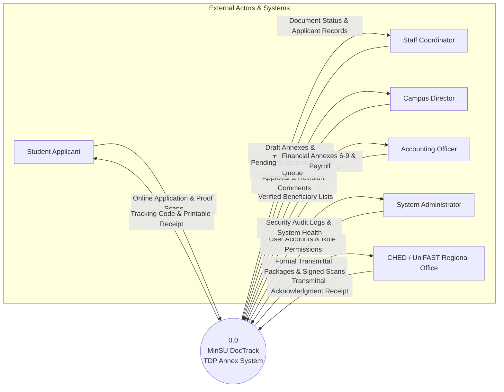
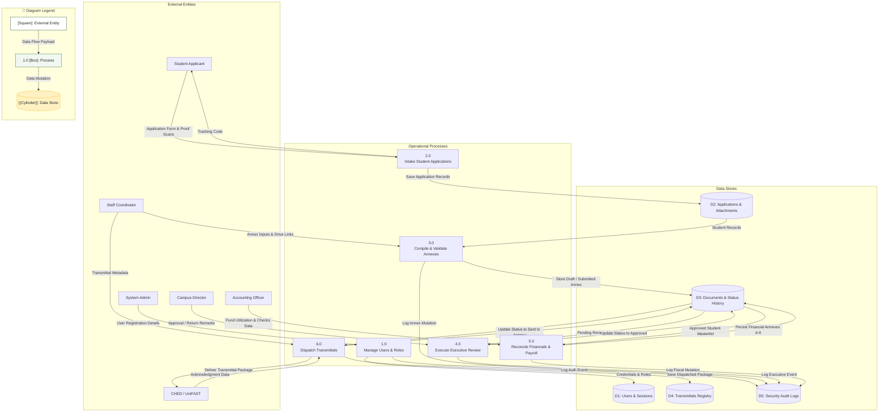

# Data Flow Diagram (DFD): MinSU DocTrack Whole System

## 1. Description
This Data Flow Diagram documents the flow of information across the entire MinSU DocTrack system. It contains the Level 0 Context Diagram and the Level 1 System Data Flow Diagram, mapping data pipelines between external entities, business processes, and data stores.

## 2. ASD-STE100 Technical Specifications
- Connect external entities to processes only.
- Do not connect external entities directly to data stores.
- Give each data flow arrow an explicit noun label.
- Provide matching process numbers across diagram levels.

---

## 3. Level 0: System Context Diagram

---

## 4. Level 1: System Data Flow Diagram

---

## 5. Diagram Legend & Symbol Guide

| DFD Element Shape | Gane & Sarson / Yourdon Notation | Technical Role | MinSU System Implementation |
|---|---|---|---|
| `[Rectangle]` | External Entity | Source or sink outside the process boundary | Students, Staff, Director, Accounting, CHED Agency |
| `(("((Double Circle))"))` | Context Process (Level 0) | Top-level system boundary | Entire MinSU DocTrack system |
| `["1.0 Process"]` | Operational Process (Level 1) | Data transformation or business logic step | `Intake Applications`, `Validate Annexes`, `Executive Review` |
| `[("[(Cylinder)]")]` | Persistent Data Store | Relational table or permanent data repository | `D1: Users`, `D2: Applications`, `D3: Documents`, `D5: Audits` |
| `-->\|Data Flow\|` | Named Flow Arrow | In-transit data packet or payload | Application forms, tracking codes, financial ledgers, audit rows |
| 🟢 Green Box | Process Node | Active workflow processing unit | Core backend services and transaction coordinators |
| 🟨 Gold Cylinder | Data Store Node | Persistent PostgreSQL / File store | Secure database tables with RLS and foreign key integrity |

---

## 6. Data Store Descriptions
- **D1: Users & Sessions**: Stores accounts, hashed passwords, roles, and session tokens.
- **D2: Applications & Attachments**: Stores student personal information, academic data, and uploaded proof documents.
- **D3: Documents & Status History**: Stores all operational and financial Annexes (1–10) with complete version logs.
- **D4: Transmittals Registry**: Stores external agency control numbers, courier details, and scanned delivery receipts.
- **D5: Security Audit Logs**: Holds immutable records of every privileged operation across the university system.
