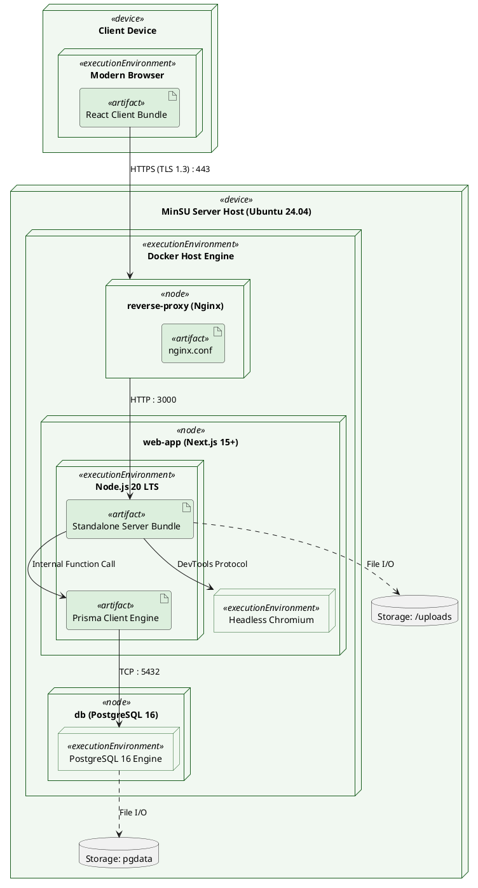

# Deployment Diagram

> **System:** MinSU DocTrack  
> **Diagram Type:** Deployment Diagram  
> **Standard:** UML 2.5 Deployment Specification

---

## 1. Purpose

The Deployment Diagram shows where software artifacts run on hardware and container nodes. It shows ports, runtimes, and storage volumes.

---

## 2. Mermaid Deployment Diagram

```mermaid
flowchart TB
    %% Styling Classes
    classDef deviceNode fill:#F6F8F6,stroke:#1B5E20,stroke-width:2px,color:#1F2A24;
    classDef dockerNode fill:#F1F8F1,stroke:#164D1C,stroke-width:2px,color:#164D1C;
    classDef runtimeNode fill:#FFFFFF,stroke:#2E7D32,stroke-width:1.5px,color:#1F2A24;
    classDef artifactStyle fill:#DCEFDD,stroke:#1B5E20,stroke-width:1px,color:#123F17;
    classDef dbNode fill:#FFF1C2,stroke:#F2B705,stroke-width:2px,color:#1F2A24;

    subgraph CLIENT_DEVICE["<<device>> Client Workstation / Mobile Phone"]
        subgraph WEB_BROWSER["<<executionEnvironment>> Web Browser (Chrome / Safari / Firefox)"]
            SPA_ARTIFACT["<<artifact>><br/>React Client Bundle<br/>(HTML5 / CSS3 / ES2024)"]:::artifactStyle
        end
    end

    subgraph DOCKER_HOST["<<device>> University Application Server (Ubuntu Linux 24.04 LTS)"]
        subgraph DOCKER_ENGINE["<<executionEnvironment>> Docker Engine & Compose"]

            subgraph REVERSE_PROXY_CONTAINER["<<node>> Container: reverse-proxy"]
                NGINX_RUNTIME["<<executionEnvironment>> Nginx 1.25 Alpine"]:::runtimeNode
                NGINX_CONF["<<artifact>> nginx.conf"]:::artifactStyle
            end

            subgraph NEXTJS_CONTAINER["<<node>> Container: web-application"]
                NODE_RUNTIME["<<executionEnvironment>> Node.js 20 LTS Runtime"]:::runtimeNode
                CHROMIUM_BIN["<<executionEnvironment>> Headless Chromium (Puppeteer)"]:::runtimeNode
                SERVER_ARTIFACT["<<artifact>> Next.js Standalone Server (.next/standalone)"]:::artifactStyle
                PRISMA_CLIENT["<<artifact>> @prisma/client Engine (.prisma/client)"]:::artifactStyle
            end

            subgraph POSTGRES_CONTAINER["<<node>> Container: postgres-database"]
                PG_ENGINE["<<executionEnvironment>> PostgreSQL 16 Alpine Server"]:::dbNode
                DATA_DIR["<<artifact>> /var/lib/postgresql/data (WAL & Tables)"]:::artifactStyle
            end

        end

        subgraph PERSISTENT_VOLUMES["<<storage>> Host Mounted Storage"]
            UPLOADS_VOL["Volume: ./uploads<br/>(Signed PDF Scans)"]:::deviceNode
            PG_DATA_VOL["Volume: pgdata<br/>(PostgreSQL DB Files)"]:::deviceNode
        end
    end

    %% Network Connections
    SPA_ARTIFACT -->|HTTPS (TLS 1.3) / Port 443| NGINX_RUNTIME
    NGINX_RUNTIME -->|HTTP / Port 3000| SERVER_ARTIFACT
    SERVER_ARTIFACT --> CHROMIUM_BIN
    SERVER_ARTIFACT --> PRISMA_CLIENT
    PRISMA_CLIENT -->|TCP / Port 5432 (Internal Network)| PG_ENGINE
    PG_ENGINE --> DATA_DIR
    DATA_DIR -.->|bind mount| PG_DATA_VOL
    SERVER_ARTIFACT -.->|read / write file stream| UPLOADS_VOL

    %% ─── 📌 VISUAL LEGEND ───
    subgraph LEGEND ["📌 Diagram Legend"]
        direction TB
        L_Dev["<<device>> Physical / Virtual Server"]:::deviceNode
        L_Env["<<executionEnvironment>> Runtime Engine"]:::runtimeNode
        L_Art["<<artifact>> Software Executable / Bundle"]:::artifactStyle
        L_Db["<<executionEnvironment>> PostgreSQL Database"]:::dbNode
        L_Art -->|Network Protocol & Port| L_Env
        L_Env -.->|File Mount / Binding| L_Dev
    end
```

---

## 3. Diagram Legend & Symbol Guide

| Visual Symbol | Syntax / Style | UML Deployment Role | MinSU Infrastructure Context |
|---|---|---|---|
| `<<device>>` Box | `fill:#F6F8F6, stroke:#1B5E20` | Physical hardware or operating system host | Client Workstation, Ubuntu Linux Server |
| `<<node>>` Container | `fill:#F1F8F1, stroke:#164D1C` | Isolated containerized execution node | Docker containers: `reverse-proxy`, `web-application`, `postgres-database` |
| `<<executionEnvironment>>` | `fill:#FFFFFF, stroke:#2E7D32` | Application runtime or software engine | Node.js 20 LTS, Nginx 1.25 Alpine, Headless Chromium |
| `<<artifact>>` | `fill:#DCEFDD, stroke:#1B5E20` | Packaged deployable binary or file | Next.js standalone build, Prisma engine, `nginx.conf` |
| 🟨 Database Engine | `fill:#FFF1C2, stroke:#F2B705` | Relational database runtime | PostgreSQL 16 Alpine Server |
| `-->` Solid Arrow | Network Communication Link | Transport protocol and network port | Port 443 (HTTPS), Port 3000 (Internal HTTP), Port 5432 (Internal TCP) |
| `-.->` Dashed Arrow | Storage Mount / Stream | Host volume bind mount or disk I/O | `./uploads` (Signed PDF scans) and `pgdata` (PostgreSQL WAL files) |

---

## 4. PlantUML Deployment Diagram



---

## 5. Node Specifications

- **Client Device**: Runs modern web browsers. Receives static assets and executes React components.
- **reverse-proxy**: Terminates TLS encryption and directs incoming web traffic to container port 3000.
- **web-app**: Executes server components, route handlers, Puppeteer PDF jobs, and Prisma queries.
- **db**: Houses user credentials, document metadata, audit records, and notification models.
- **Storage Volumes**: Preserves signed physical scans and database files on host storage.
